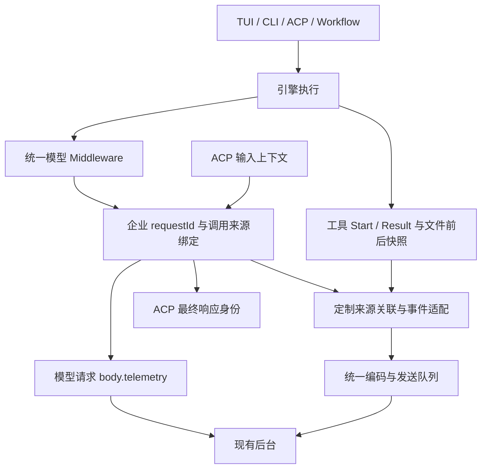

# Session telemetry 路线技术评审（2026-11-19）

## 1. 评审身份、范围与结论

- 评审日期：2026-11-19（Asia/Shanghai）。
- 评审工具：OpenAI Codex，具有本地仓库读取能力；不推断未公开的精确模型版本。
- 被评方案开发 AI：按既有 self-review.md 记录为 Kimi-K3.1-Pro / CodeBuddy。
- 轮次：本次独立技术评审；尚未完成发现项修复和增量复审。
- 责任人裁决：待逐项裁决；本文不代填签认，不改变既有签认或实施授权。
- 被评对象：`feat/telemetry-exploration`，固定提交 `71501235f92b30eb9f576d9125a646f43a667e0c`。
- 对照对象：本地远端引用 `origin/main_aixcoding_cli_0.35.2`，固定提交 `a9b169626c5fde9169955a836a72cd2e4df71651`。
- 交付事实：责任人在本次会话明确确认，源码集中改造版 0.35.2 已交付。本文以此为替代评估起点，不以历史待办重新否定交付，也不声称本评审亲自完成生产验收。
- 评审范围：文档方案可行性、证据充分性、并发/重试/压缩边界、替代交付条件及验证策略。不是新生产代码验收或 PR approve。

**评审建议：补充设计与关键判别实验后，再裁定替代实施。** 正常未压缩、文件稳定且依赖数据完整的主链已有局部可行性证据；尚不足以证明能够替代已交付 0.35.2。本文提出三个实施前候选 blocker、一个替代交付前候选 blocker 和两个建议，均待责任人 confirm/reject。

本文不推翻已批准的 best-effort、不做崩溃补报、workflow 退出、删除三个时间字段、ID 原值及 BR-8 撤销等裁决。评审针对剩余范围内的设计闭合性，不要求恢复所有旧能力。

## 2. 规范依据与证据口径

遵循 `DEVELOPMENT.md` 的 R1/R5/R7/R8/R10/R12、§4.1/§4.2/§6、`DIRECTORY.md` 的文档落点及 `PEER-REVIEW-HOWTO.md` 的证据抽查和候选发现原则。本文归入既有探索批次 research，self-review.md 追加索引，实际验证另记 verification.md；不新建实施批次、不改 design/ADR 正文、不自批豁免。

| 等级 | 证据类型 | 使用边界 |
|---|---|---|
| A | 本轮直接读取固定提交的文件或运行命令 | 证明文件契约、源码机制或实际命令结果 |
| B | 分支既有实验记录 | 引用其结果和限定，不冒充本轮全部复跑 |
| C | 根据时序和契约推导的风险 | 未复现故障明确标为待验证 |
| D | 责任人已记录裁决或本次明确说明 | 不把 AI 建议升级为人已批准 |

| 依据 | 固定提交中的位置 | 用途 |
|---|---|---|
| [requirements.md](../requirements.md) | 7、14–19、43–55、78–87 行 | 对照基线、身份和范围裁决 |
| [after-turn-lifecycle.md](nodes/after-turn-lifecycle.md) | 267–332 行 | logical/pass、通知合并、异步读取及 R2 候选 |
| [session-reconstruction.md](session-reconstruction.md) | 31–71 行 | 保存、数据缺口及当前轮压缩 |
| [performance-and-lifecycle.md](performance-and-lifecycle.md) | 21–61 行 | 扫描增长、去重及队列原型边界 |
| [plan.md](../plan.md) | 19–40、144–172 行 | 实施顺序和组织策略冲突 |
| [backend-change-requests.md](backend-change-requests.md) | BR-1/5/6/7/9/10 | 后台关联、格式、幂等和取消契约 |
| 对照提交的 telemetry-migration/design.md | §3–§5 | 现有集中模块、运行时来源和快照 |
| 对照提交的 service/aixcoding/telemetry/model.py | TelemetryModelMiddleware.process/_prepare | 请求前企业 ID、body.telemetry 和来源交接 |
| 对照提交的 service/aixcoding/telemetry/events.py | tool_start/tool_result | Start 参数快照及 Result 文件快照消费 |

相对链接用于仓库内导航；后续行号会变化，准确历史对象以头部完整提交号和章节为准。

## 3. 架构对照与技术取舍

### 3.1 已交付源码集中采集路线

企业逻辑已集中在定制包，上游接线提供执行时事实。主要维护成本是执行边界、来源交接和快照语义，不能以“企业逻辑仍散落所有源码”作为替换依据。

### 3.2 拟议 session 重建路线

```mermaid
flowchart TD
    E["TUI / CLI / ACP"] --> R["引擎执行"]
    R --> H["模型请求 attempt header"]
    H --> B["后台保存每请求 attempt 原值"]
    R --> D["session / trajectory / mutation / blob"]
    R --> F["轮末 save 与 checkpoint"]
    F --> N["run 身份与 saved 通知入队"]
    N --> Q["per-session worker"]
    D --> Q
    Q --> J["重建模型、工具、代码关联"]
    J --> K["catalog 过滤与独立报告"]
    K --> B
    B --> X["原请求与报告 join"]
    P["ACP 输入捕获"] --> K
    R --> L["响应时 live history 身份选择"]
    L --> O["ACP 最终响应身份"]
```

ACP 仍需运行时输入捕获和 live history，因此整体不是纯离线 session.json 分析。减少接线把部分上游依赖转移到了持久化格式、数据保留和保存时序。

| 维度 | 已交付 0.35.2 | 拟议 session 路线 |
|---|---|---|
| 事实来源 | 执行时来源、参数和快照 | 保存后联读多个数据源 |
| requestId | Middleware 企业 ID，SDK 重试可共用 | 成功模型响应的 HTTP attempt ID |
| 工具协议 | save/PENDING/terminal | 一次 final snapshot，后台需配套 |
| 维护负担 | 执行挂点、来源登记、事件生命周期 | reader、跨文件一致性、压缩与归属、队列生命周期 |
| 证据成熟度 | 已实现，有真实链路和报文对拍记录 | 原型和局部实验，无生产替代闭环 |

不把 ID/协议变化和已批准缩小范围带来的简化全部计算为 session 架构收益。对照应按调用、工具 occurrence 和语义关系建立映射，不要求两边随机 ID 文本相等。

## 4. 发现项及关闭条件

P1/P2 为风险优先级，blocker/suggestion 为建议处置类型；阶段是阻塞边界。所有发现均待责任人裁决，不能自行认定已接受或已关闭。

| ID | 优先级/类型 | 建议处置阶段 | 问题 | 当前状态 |
|---|---|---|---|---|
| F1 | P1 / blocker 候选 | 第一批设计与判别实验 | 缺文件读取一致性边界 | 待裁决，未修复 |
| F2 | P1 / blocker 候选 | 第一批设计与判别实验 | 合并通知未区分 retry pass | 待裁决，未修复 |
| F3 | P1 / blocker 候选 | 扩大 reporter/ACP 开发前 | 当前轮压缩数据充分性未验证 | 待裁决，未修复 |
| F4 | P1 / blocker 候选 | 替代交付前 | 缺迁移、单写和回退契约 | 待裁决，未修复 |
| F5 | P2 / suggestion | 测试计划与验收 | fail-closed 缺完整率验收 | 待裁决，未修复 |
| F6 | P2 / suggestion | 下一次按 plan 续接前 | 新旧操作步骤冲突 | 待裁决，未修复 |

### F1：异步读取没有绑定本次保存的数据版本

- 位置：after-turn-lifecycle.md §14.2，290–296 行。
- 事实（A）：dispatcher 只合并并 put_nowait，文件分析和网络留给 worker；通知含身份与 saved，但未定义跨文件一致版本或读取屏障。
- 风险（C）：本轮保存→通知排队→下一轮/回滚/压缩改变文件→worker 才读取。FIFO 约束分析任务之间的顺序，不约束引擎写入；不可变通知不等于不可变数据。多个文件还可能来自不同保存时刻。
- 影响：expected-turn 可拒绝错归属，不能恢复已消失的事实，不能证明组合数据属于同一有效版本。
- 建议：实施 design 比较保存版本校验、受保护读取阶段、当前轮不可变快照等机制；新增 I/O、锁等待和 R2 必须计回总成本。本文不代选实现。
- 关闭证据：阻塞 reader，在其前后执行下一轮保存、回滚和压缩，证明不会拼接跨版本事实；不能完整读取时按责任人批准的条件降级。

### F2：logical-turn 合并可能遗漏新 retry pass

- 位置：after-turn-lifecycle.md §14.1/§14.2，278、292–296 行；performance-and-lifecycle.md §3。
- 事实（A）：retry 可保持 logical turn 而生成新 pass；合并键为 `(session_id, logical_turn_id)`，未定义 pending/running/completed 状态下新 pass 的处理规则。
- 风险（C）：第一次 pass 已分析或正在分析，后续 retry 新增模型和工具事实。如果新通知被当成重复丢弃，就会漏报；若刷新 pending，也必须定义运行中任务如何重新调度。
- 证据限定：队列实验每次 notify 直接 put，没有合并集合、pass 或版本协议，不能证明合并安全。尚无生产实现，不声称已复现具体漏报 bug。
- 建议：区分同 pass 重复通知与新 pass 新事实，比较 pass 级接收加记录级幂等，或带版本重新调度。
- 关闭证据：同 logical turn 两个 pass，在首任务排队、运行和完成后三个时点通知，新增事实均保留，旧记录不重报，同 pass 重复通知不重复投递。

### F3：当前轮压缩判别不应全部后置第三批

- 位置：session-reconstruction.md §6，60–71 行；plan.md 146–148 行。
- 事实（A/B）：保存发生在本 run 压缩之后，部分压缩不保证完整原内容；真实 engine compaction×reader 样本未完成，compaction/edit 排在第三批。
- 风险（C）：长 turn 先执行 A1/工具/代码修改，再触发压缩，轮末首次分析时内容已被删减。这是当前轮首次上报，不是启动补扫历史。
- 影响：若 trajectory+mutation 也无法补齐必要参数、身份和代码事实，数据源本身不充分；增加 reporter 或 ACP 接线无法恢复这些信息。
- 建议：前置最小真实压缩判别实验，完整压缩矩阵可留第三批。
- 关闭证据：真实 engine 同 turn 多次调用与工具后触发实际压缩，只凭保存数据恢复早期 A1/T/代码记录，核对数量、关联和必需字段；不能恢复则裁决补采或差异并重估成本。

### F4：缺少替换已交付 0.35.2 的迁移与单写设计

- 位置：requirements.md 7、14–19 行；plan.md 三批次与最终整体合并策略。
- 事实（A/D）：研究主要对照 0.28；责任人已确认集中改造的 0.35.2 已交付。读取探索提交时未发现现有定制 telemetry 产品目录。独立开发基线本身不是缺陷，但最终替换不能省略迁移设计。
- 风险（C）：两套 ID 和协议不同，双发送不能假定后台现有幂等可合并；直接移除旧实现又可能退掉近期已交付的技能及项目名等修正。
- 建议：补以已交付版本为基线的保留/复用/替换/删除清单、唯一生产发送权、后台/桌面切换及回退安排。验证阶段输出隔离接收端，不默认双写生产安全。
- 关闭证据：相同受控执行输入对照两链路，逐项解释批准差异；切换/回退无未声明双发和漏发窗口，近期修正有覆盖。
- 阶段限定：阻塞替代交付，不要求隔离实验前实施生产迁移，不否定 0.28 需求来源。

### F5：不串号不能代替完整率验收

- 位置：session-reconstruction.md §3/§4；plan.md 批次1退出条件。
- 事实（A/B）：save=False、trajectory 缺失、终态 gap、blob 缺失会跳过不同记录；run-owned 身份不补工具内容。
- 风险（C）：验收若只看不借旧值，空结果也可能通过，不能判断统计用途是否满足。
- 建议：逐场景定义预期 LLM/tool/ai-code 数量、必需字段、允许跳过条件，分别验正确性与完整性。best-effort 不自动授权常态或配置性漏报。
- 关闭证据：矩阵列明完整支持/批准降级/不支持，包含轨迹关闭、保存抑制及异常组合；具体底线由责任人定，不虚构覆盖率阈值。

### F6：旧操作步骤与最新组织裁决冲突

- 位置：plan.md 21–29、170–172 行。
- 事实（A）：新策略不建探索独立 PR，旧步骤仍要求建分支、独立 PR 合主干后再实施，测试提交顺序也保留旧策略。
- 影响：可能引导后续执行者重复建分支、重复签认或提前合主干。
- 建议及关闭证据：将旧操作标成历史或移除有效指令，只保留一套当前下一步；不回写历史 verification。

## 5. 已知依赖与不重复列为新发现的事项

| 项目 | 评审意见 | 验收要求 |
|---|---|---|
| BR-1/5/6 | 已承认的后台前提，不重复冒充新问题 | 真实 attempt 保存、32hex/混存、独立报告 join 和原子幂等 |
| BR-7/9/10 | ai-code 幂等、取消及中间 attempt 口径 | 不伪报成功、不静默覆盖冲突，不把目标协议写成现网已支持 |
| 字段 parity | 最小 DTO 不是永久删除许可 | 对照已交付版本与原需求，逐字段保留批准差异 |
| 性能/背压 | 30 轮数据说明增长，不证明长会话不可接受 | 实测大文件/慢盘，明确容量与丢弃底线 |
| 数据治理 | 代码、路径和参数可能外发 | 权限、脱敏、保留和删除按上线要求验收 |
| catalog 过滤 | 判断时刻与调用时刻不同已登记 | 缓存失效、缺文件和不可判定策略落实 |

不重做已证明的普通 A1/A2/T 样本，不要求崩溃恢复、持久化 exactly-once、providerCallId 或已删除的三个时间字段。

## 6. 建议验证矩阵及停止条件

下列均为建议新增验证，本轮未执行，不计入 passed。

| 实验 | 条件 | 核心判别 | 建议阶段 |
|---|---|---|---|
| V1 | reader 屏障+下一轮/回滚/压缩 | 一致版本、归属和缺失 | 第一批 |
| V2 | 同 logical 两 pass，首任务排队/运行/完成 | 新事实保留与真重复合并 | 第一批 |
| V3 | 本轮早期工具/修改→实际压缩→保存 | 必需事实仍可恢复 | 第一批，扩大开发前 |
| V4 | 连续 edit、审批改参、多 mutation、失败/取消 | 逐次内容与批准差异 | 最小判别前置，完整矩阵第三批 |
| V5 | 同受控输入、双链路隔离接收 | 字段/关系/数量及切换 | 替代交付前 |
| V6 | 真实后台/桌面，retry/Responses retrieve/32hex | 原请求、报告、最终身份闭环 | 内网验收，不阻塞外网 mock |

路线停止与重评条件：

1. 必需事实未保存且其他来源也无法恢复，责任人不接受漏报：当前事后重建假设不成立，需补采或重评。
2. 无法以可接受代价得到一致数据：重评异步读取、快照或受保护读取，不继续把 FIFO 当一致性保证。
3. 后台关键关联不可实现：依既有 Q5 重评 N1-A 完整成本，不自动承诺后台零改动。
4. 补采、快照、专用日志和新接线使复杂度接近或超过已交付方案：可实现不等于值得替换，应以真实成本交责任人裁决。

## 7. 规范核对与授权边界

| 检查 | 本轮结论 | 限定 |
|---|---|---|
| R1/R12 | 已比较现有集中模块与事实来源，F4 要求补替代成本 | 四/五候选文件数不是总升级成本证明 |
| R2/R3 | 仅 research 报告和记录追加，无上游产品/测试修改 | 实施候选不是批准，无新源码 marker |
| R4/R9 | 既有 aixcoding/docs/batches 批次内落位 | 无产品 tier/import 改动 |
| R5/R6 | 不修方案、不改签认、不处理无关未跟踪文档 | 只提交本次明确路径 |
| R7 | 实际命令另记 verification.md | 局部实验不等于新链路端到端通过 |
| R8/R10 | self-review 追加索引，发现等待裁决 | 既有签认不自动关闭本轮发现 |
| R11/R13 | 无第三方依赖或门禁豁免新增 | 不因环境限制添加 skip |
| API/异常 | 本轮无新 API/import/运行逻辑 | 文档契约检查不代替生产代码评审 |
| closure | 实际结果单独记载 | 工具通过不证明技术可行 |

本文是评审建议，不新增已生效架构决定，因此不修改 ADR。后续接受的机制若触发 ADR checklist，由对应实施批次独立记录和签认。

## 8. 证据抽查、局限与最终意见

本次抽查固定探索提交的 `test_after_turn_queue.py`：三个用例覆盖同 session FIFO、跨 session 并发及有界 flush/关闭。前一轮在临时目录运行得到 `3 passed in 0.03s`；`uv run --no-sync` 提示环境不满足固定 Python 3.14.10，不能冒充目标环境验收。报告落盘后的实际命令和输出另记 verification.md。

测试有效性边界：`_run()` 若将串行 await reporter 改为并发调度，可破坏首个 FIFO 用例；关闭取消/等待 worker 的行为被破坏，可由关闭用例暴露。但 notify 无去重逻辑，reporter 无真实 reader，无法覆盖 F1/F2；没有真实压缩引擎样本，无法覆盖 F3。

本轮没有连接真实后台、读取私人 session、执行真实压缩×reader 或验证新生产 dispatcher。历史实验数量重叠，不相加为本轮总数。未复现风险不写成已发生代码缺陷。

**最终意见：有条件可行，替代可行性尚未证明。** 优先裁决 F1–F3，通过判别后再扩大生产开发；F4 在替代交付前关闭，F5/F6 明确处置。关键假设失败时允许修改路线或废弃长期分支，不因探索已签认而继续投入。

本评审为独立第二 AI 评审，使用工具与被评方案记录的开发 AI 不同，直接读取仓库证据；仍可能共盲，终裁在责任人。不声称另一 AI 再次独立评审了本报告，不自行宣布候选 blocker 已关闭。

## 9. 对方案方回复的复核与评审口径修订（2026-11-19）

### 9.1 来源、范围及状态

责任人转交了方案方针对 F1–F6 的分析回复，并指示继续。本节记录 Codex 对回复的独立事实核对与评审意见调整。回复 AI 的精确模型标识未提供，不代填；不将其推荐裁决或责任人的“继续”写成实施 design/R2 已签认。

本节是对本报告评审措辞和建议的补充，前文保留为首轮记录；涉及 F1/F5 的当前解释以本节为准。没有修改产品实现、原方案 design 或责任人签认。六项的责任人裁决及验证关闭状态仍待逐项记录，不因文字分歧收敛而自动关闭。

### 9.2 逐项复核

| 项目 | 核对结果与当前评审意见 | 尚需满足的条件 |
|---|---|---|
| F1 | 接受部分修正。目标是记录级事实一致和关联正确，不预设全局原子快照；不同保存时刻的兼容事实可合法组合 | 延迟读取正确；破坏性改写后不串接；不可恢复时按批准范围显式降级 |
| F2 | 接受通知和 reader 均需补契约。三元组通知键是合理候选，不直接记为已选定实现 | 区分 pass 新执行、前序关联来源和纯重放；新 pass 不被通知合并丢弃 |
| F3 | 接受定位为已登记风险的排期修正，不声称首次发现压缩问题 | 最小真实当前轮压缩实验前置，完整矩阵仍可后置 |
| F4 | 与回复一致，只作为最终替代交付门禁 | 明确单写、切换和回退，不默认要求历史数据迁移或立即选开关机制 |
| F5 | 修正首轮概括。现有正常及降级实验已有精确记录数，不能笼统认定只验不串号或正常空结果也通过 | 补统一支持/批准降级矩阵及剩余场景数量和字段标准 |
| F6 | 确认回复补充的遗漏位置 | plan.md 与 review-handoff.md 的过期有效指令一起处理，历史证据不回写 |

### 9.3 F1：记录级一致性与可接受漏报必须分别裁决

只要旧 pass 的身份、工具终态、参数和 blob 内容仍完整且可验证，延迟到下一轮保存后读取也可能生成正确记录；不同文件不必拥有同一个全局版本号。首轮“不会拼接跨版本事实”应收窄为“不会拼接不兼容、归属不同或证据不足的事实”。原子快照、版本校验或锁是候选机制，而不是预设唯一答案。

关闭判别应分别证明：正常追加后前一 pass 仍可精确重建；回滚/压缩后不跨 pass、A/T 或 mutation 错配；缺失时明确记录原因。若已经批准这些具体场景的漏报，显式跳过可以满足其降级契约；若未批准，不能仅以 best-effort 自动认定符合统计需求。实验需列出恢复与跳过的记录，交责任人裁定是否需要快照或受保护读取及其成本。

### 9.4 F2：pass 级调度不等于删除前序关联来源

直接核对 `aixcoding/tests/telemetry/test_tool_identity_persistence.py:731–755`：方向 reader 的参数是 `session_dir/session_id/expected_turn_id`，目前按 logical turn 过滤，没有显式 expected pass 契约。因此缺口不只在队列合并键。

普通通知按 `(session_id, logical_turn_id, pass_id)` 区分是合理候选；同 pass 重复可合并，不同 pass 在首任务 pending/running/completed 时均不能静默丢弃。由于生产合并器尚未实现，“当前键必然已经造成漏报”仍非已复现事实。

reader 的设计须区分：

1. 当前 pass 新产生、需要上报的模型与工具执行事实；
2. 为关联这些执行而必须读取的前序来源；
3. retry 中只重放或继承、没有再次实际执行的历史内容。

不能简单排除所有不属于当前 pass 的来源，也不能每 pass 重新上报整个 logical turn。按原始执行身份保持归属，记录级幂等作为第二道防线。V2 除数量外，还应验证跨 pass 关联及旧工具不重报。

selected Agent 1001 仍按 logical turn 保持一条；不能随着普通通知变为 pass 级而每 pass 发一条。多个 pass 间“首个成功主模型调用”的选择及重复处理必须稳定，不用最后 A2 替代首个成功 A。

### 9.5 F5/F6 的事实更正与补充

已直接核对 test-plan.md:61–68：正常两轮要求 `3 LLM / 1 tool / 1 ai-code`，工具终态 gap 保留 LLM、跳过 tool/ai-code，blob 缺失只跳过 ai-code，save=False 空报并记录原因。因此正常样本空结果会违反既有数量断言。F5 当前问题是统一支持/降级矩阵和未覆盖场景的完整性标准不充分，保留现有精确断言，不虚构覆盖率百分比。

已直接核对 research/review-handoff.md:267：“当前探索批次独立 PR”与长期根分支策略冲突，是 F6 的新增定位；应与 plan.md 的同类有效指令一起清理。此轮只记录定位，未代替方案方修订原文。

### 9.6 当前结论与后续边界

双方均未提出足以直接证明 session 路线不可行的事实，亦未证明可以替代已交付版本。建议采用本节收窄后的 F1/F5，补完整 F2 的来源与执行边界，保留 F3 的前置判别和 F4 的交付阶段边界。

后续需要责任人逐项裁决、按实施 design/R2 落盘并运行判别实验。当前“接受回复中的合理修正”只表示评审意见调整，不表示方案已修复或 blocker 已验证关闭。
