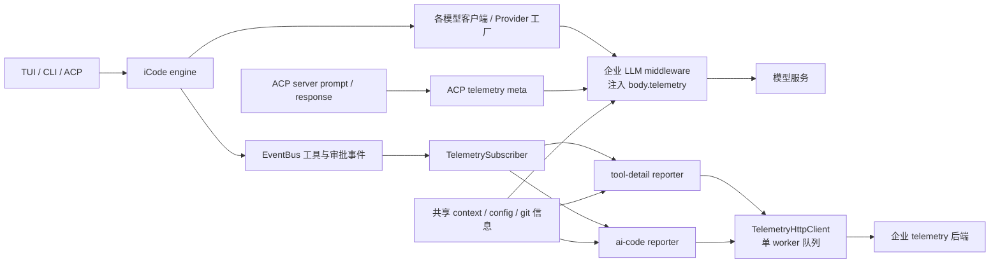
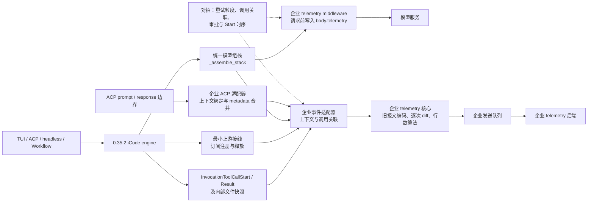

# 企业埋点迁移技术方案

- 编写日期：2026-11-11
- 状态：已确认
- 责任人：兰荣达
- 确认日期：2026-11-11
- 确认意见：已复核 §4.2/§4.4 补充与 R2 附件改动，确认
- 旧报文基线：`019d12b13374d15e14241cbdc0895af4184821c9`，`main_aixcoding_cli_0.28.0_final`，0.28.0。
- 目标工程基线：`10ec90eefc75274ba9b1acd8c25f4a39964234b1`，`main_aixcoding_cli_0.35.2` 的起点，0.35.2。
- 需求、验收矩阵和当前进度见 [requirements.md](requirements.md)、[test-plan.md](test-plan.md)、[plan.md](plan.md)。设计决策见 `ADR-telemetry-migration--compatibility-adapter`。
- §7 及其逐行审阅附件为本次签认范围。实施验收使用 §8 的对拍矩阵。

## 1. 目标及判定原则

保留现网后端可以观察到的报文结构、字段含义、触发条件、关联关系和顺序，把上游升级时的适配集中在少量明确位置。

兼容目标为旧基线最终代码的实际报文，而非旧设计中的字段超集。旧文档和代码存在差异，必须先建立旧实现报文样本，再决定是否修正历史行为。

验收分为三个等级，实施报告逐项列出，不合并成一个“兼容”结论。

1. 必须一致。接口路径、字段类型、缺省规则、枚举、事件粒度、同次调用关联和逐次编辑算法。
2. 允许自然变化。随机 ID 的具体值、真实运行时间、耗时、目标版本号，以及不同模型响应带来的实际业务值。只允许规范化具体值，不允许隐藏字段缺失、错挂、漏报或重报。
3. 待确认的历史偏差。旧版缺陷和新版新增能力单独登记，须明确批准后调整口径。

“同一批真实会话对拍”应理解为同一组输入、审批和预录模型/工具响应在两个隔离工作区重放。直接让真实模型跑两次不会产生相同工具和代码，不适合逐报文等价判定。

## 2. 路线选择

| 路线 | 字段及逐次编辑兼容性 | 升级影响 | 本期结论 |
| --- | --- | --- | --- |
| 原样迁入旧全部挂点 | 数据最接近旧版，但旧客户端结构已变化 | 继续分散追踪内部改动 | 用作行为对照，不原样搬接线 |
| 官方 Hook / OTel + 网关 | 基础数据可得，缺逐次编辑快照和部分企业关联 | 接口级依赖较少 | 用于旁路对账，不作为唯一生产数据源 |
| 0.35.2 Python 扩展 `before_tool` / `after_tool` | after 能取得审批修改后的最终参数及结果，但 `ToolResult` 无逐次快照、`ToolCall` 无原始 provider ID 和模型关联 | 每个 profile 按扩展装配，before 可随改参重复执行，after 失败可能替换模型可见结果 | 作为候选参数出口评估；单独使用无法保住旧口径，且上报故障不得影响模型结果 |
| ACP Wrapper + 查询 | 桌面 ACP 可代理，TUI 不经过，diff 有聚合语义 | 依赖私有 ACP 扩展 | 保留桌面扩展消费，不承载 TUI 主采集 |
| 企业报文模块 + 引擎薄适配 | 可以直接使用每次工具事实和文件快照 | 主要适配少数内部边界 | 推荐 |
| 贡献通用接口到上游 | 接口足够时可替换本地接线 | 依赖上游接受并维护契约 | 长期替换路径 |

R1 结论：现成公开接口不能完整提供旧版逐次快照、原始工具 ID 和请求时 telemetry。为保留现网口径，本期保留必要上游接线，企业报文业务全部放入定制包。

特别说明：旧版已经采用 EventBus 订阅。收益必须通过减少重复接线、集中适配、复用报文模块和跨版本演练证明，不能把“改成事件订阅”本身当作新收益。

## 3. 结构及模块边界

### 3.1 0.28.0 现网结构：企业逻辑与上游接线交织

下图是旧基线的实现结构，不代表推荐做法。企业埋点代码虽然已有
`chrys.aixcoding.telemetry` 子包，但模型 middleware 的装配、ACP 元数据和事件所需字段分别散在
上游路径中；模型接线还跟随旧客户端/Provider 结构。升级时需要重新确认这些分散位置是否仍存在、
仍在同一语义时序中。



**读图要点：**旧版的报文编码和上报已有一定聚合，但“从哪里取得模型调用、工具事实、ACP 上下文”仍分布在
多个上游文件。它是本次迁移的行为基线，不应按文件位置原样复制。

### 3.2 0.35.2 目标结构：企业模块集中、上游仅保留薄适配

下图是本轮的**目标设计，尚未实施完成**。实线中的“最小上游接线”仅负责将引擎已有的真实事实传给企业
适配器。旧报文编码、从逐次快照计算行数、关联表和发送队列收敛到企业模块。虚线框列出实施后需要对拍的边界。



**收口边界：**上游保留的内容是生命周期、统一组栈、真实工具事件/快照以及 ACP 协议边界；企业领域规则不进入
这些上游文件。将来上游若提供经过对拍验证的等价公开接口，可进一步删除对应接线。

```text
TUI / ACP / headless / Workflow
                  ↓
        iCode 引擎和模型客户端
                  ↓
     企业适配层（上下文、ID、逐次快照）
                  ↓
       企业内部数据记录 + 旧口径编码器
           ↙                    ↘
模型发送前 body.telemetry    独立上报队列
                            tool-detail / ai-code
```

新增文件范围如下。目录相对仓库根，定制模块通过公开函数复用通用能力。

| 路径 | 职责 |
| --- | --- |
| `src/chrys/kernel/aixcoding/telemetry/context.py` | 显式 pass 绑定和隔离，提供可安全调用的恢复函数 |
| `src/chrys/kernel/aixcoding/telemetry/provenance.py` | 来源对象与工具操作的有界内存登记 |
| `src/chrys/service/aixcoding/telemetry/model.py` | 模型 middleware 和构建期 factory 包装，维护每次请求的企业来源和报文搭载 |
| `src/chrys/service/aixcoding/telemetry/{events,reporters,delivery,context}.py` | EventBus 适配、旧报文编码、逐次行数和代码片段、发送队列、配置/auth 接口复用、Git 和桌面上下文 |
| `src/chrys/orchestration/aixcoding/telemetry/{lifecycle,skills}.py` | bus 生命周期装配及已解析技能使用记录 |
| `src/chrys/app/aixcoding/telemetry/acp.py` | ACP 入站字段验证、prompt 作用域及旧 response metadata |
| `aixcoding/tests/telemetry/`、`aixcoding/mock/telemetry/` | 契约对拍与 stdlib mock，测试文件见 test-plan.md |

新产品目录包含必要的包初始化文件。kernel 层只依赖 kernel/foundation，保存运行期关联，配置及网络处理归 service。ACP 模块通过 service 层的上下文接口与模型 middleware 共享同一次 prompt 的捕获状态。轨迹和企业来源分别管理。

订阅器同步完成轻量快照和入队，避免保存可继续变化的 args/metadata 引用。网络与 Git 子进程移出 EventBus inline 回调。Git 按 resolved cwd 缓存；首次采集在执行前准备，上报时保留明确的上下文版本。

## 4. 采集与接线设计

### 4.1 生命周期与上下文

在引擎现有 `_subscribe_event_handlers()` 中按 bus 幂等注册。目标提交的 `start()` 和 `prepare()` 都经此入口，覆盖正常启动和恢复。引擎 `_release_resources()` 的现有释放任务调用定制关闭函数。注册完成后再接受首条业务事件。

监听 session ready、工作区变化、profile 变化、turn 开始、审批模式和审批决定，并跟随子调用绑定上下文。引擎关闭时解除订阅，有限时排空队列，确保任务和凭据不残留到其他 session。

TUI 直接复用引擎事件。ACP、headless 和 Workflow 通过同一适配层采集，不以 UI 是否展示工具卡片决定是否上报。外部 ACP 子代理内部模型请求没有本引擎事实来源，必须单列未覆盖范围，不推算调用次数。

### 4.2 模型请求与调用关联

目标 `service/llm/clients.py::_assemble_stack` 是已核实的统一模型组栈点，含 `ChatMiddlewareLayer(wire_client)`，覆盖主 Agent、内部辅助调用、子 Agent 等路径。优先在此装配企业 middleware，替代旧 `instrumented.py` 及三个 provider 工厂分别接线。该层形参为 `middleware: Sequence[ChatMiddleware] | None`，定制 `build_middleware()` 返回 middleware 序列后整体装入；禁用、装配失败或返回空序列时保持原空链。

模型请求前构造旧 `extra_body.telemetry`，复制 options 与 extra_body 后合并旧字段。三个构建入口显式提供实际 Agent profile 和工作区，由定制包为原工厂调用绑定短生命周期构建作用域。包装器保持原工厂参数与异常语义，只调用原工厂一次，在同一任务内恢复上下文。子 Agent / Workflow 的企业 session 取父会话，模型传输继续使用各自路由。工作区切换后由引擎重建提供新的构建上下文。KernelConversation 用实际 RunRequest 与 pass 标识绑定定制上下文，调用结束恢复该绑定。没有本次 pass 的辅助调用仅使用其真实构建上下文。

每次 middleware 进入生成企业 `requestId` 与 LLM span，用内部 `model_source_id` 关联。企业轮次 `spanId` 使用旧 namespace、session 与当前轨迹 turn 的 UUID5 算法。缺少可确认的 turn 时按旧字段规则省略。provider ID 负责兼容旧 `funcId`。kernel 操作 ID 负责本地 Start / Result 配对。HTTP attempt ID 供对账诊断。

本地工具统一按最终响应 Content 的对象身份登记来源，在 kernel 为实际待分派的调用分配操作 ID 时完成交接。订阅器按操作 ID 获取来源，并在 Start 保存报文字段，Result 消费同次缓存。带轨迹和无轨迹使用同一条交接链。托管工具在流更新、终态和失败观察点按实际 Content 对象登记首次可确认来源，展示适配从观察到的 call/result 读取来源，把来源随操作缓冲。终态重建时使用实际内容的来源，订阅器以展示 occurrence 配对已经发送的 Start。历史内容及来源缺失按 §4.3 处理。

对象索引采用弱引用并核验对象身份。操作与来源索引按会话、invocation 和 pass 隔离，设有容量与过期时间。工具终态释放 Start 状态，拒绝或取消的未消费登记由 pass 收尾与过期策略回收。已排队的托管来源可保留至终态、关闭或到期。引擎关闭时移除该 bus 的状态，关闭、排空及失败诊断由定制模块处理。

**模型发送层首组探针已确认 SDK 重试口径。** 旧版 Chat Completions 先返回 429 再成功，两个 HTTP 请求复用同一企业 `requestId`。新版同一场景的两个 `Chrys-Request-Attempt-Id` 不同。企业 ID 保留在 SDK 重试外层，不能直接复用 HTTP attempt ID。各重试边界的实测记录见 [verification.md](verification.md)。

第二组探针确认统一 middleware 能观察到以下边界。对可直接复现的旧场景，保留旧企业 ID 分配粒度。其他路径按表验证候选规则。

| 场景 | 观测结果 | 企业 ID 规则 |
| --- | --- | --- |
| SDK 429 重试 | 旧版 2 次 HTTP 发送共用 1 个企业 ID。新版 2 个 HTTP attempt ID | SDK 外层分配一次 |
| Kernel wire retry / stall fallback | 旧版脚本 wire 分别观测到 3 次发送/3 个企业 ID 和 4 次发送/4 个企业 ID。新版 middleware 次数分别为 3 和 4 | 每次进入分配新 ID，已有工具执行保持原归属 |
| Blank / overflow resend | 新版各 2 次脚本 wire 发送、2 次进入 | 每次进入分配新 ID，只有实际执行的工具进入工具上报 |
| Anthropic thinking-binding resend | 新版 2 次真实 SDK 发送、1 次进入 | 候选为同一 ID，接线后检查两次 body |
| 服务端存储，失败后重建响应 | 新版 2 次 POST、2 次进入 | 每次创建分配新 ID |
| 服务端存储，断流后续读同一响应 | 新版 POST → GET，2 次进入。新旧 provider 适配器均调用 retrieve，GET 无模型请求体 | 保持 GET 无 body。旧版实际工具上报引用续读 middleware 新生成的企业 ID，与创建 POST 的 ID 不同。迁移保留该归属，并在对拍中确认 |

辅助调用继续按旧规则发送 `eventSubType=system`，但不覆盖主会话最终 requestId，不触发选定 Agent 使用记录。新版新增 side-question 等调用独立列入覆盖矩阵，不冒充旧版已有场景。

### 4.3 工具调用和逐次编辑

订阅 InvocationToolCallStart/Result，补齐原 provider ID、实际 profile、workspace 和稳定 occurrence/模型关联。主工具、子工具、托管工具分别核对发布点。已有字段定义并不证明所有发布点已经赋值。

旧工具状态顺序保持 `save → update(PENDING=3) → terminal update`。结果按结构化 metadata 分类，不能单凭结果文本或 UI completed 判断成功。只产生一个终态，兼容重试时保留实际新执行的 occurrence。

托管工具的 `save` 从首次触发该 Start 的实际模型调用取 `requestId`、`spanId` 和 `parentSpanId`。正常完成关联当前调用。由 GET 续读首次触发的 Start 使用续读生成的 `requestId` 和 `parentSpanId`，`spanId` 仍对应同一轮次。若 Start 已在 POST 阶段上报，GET 续读后的结果与已有工具记录配对。失败和并发按实际来源归属，无法确认来源时省略这三个可选字段、记录本地诊断，并继续发送原有工具记录。旧版错挂样本见 [verification.md](verification.md#2026-11-11-旧版托管工具报文归属)。

`metadata.file_snapshot=(before, after)` 是逐次写入真值。工具行数继续使用旧 splitlines/ndiff 算法。ai-code 仅对旧版支持的成功 write_file/edit_file 且 blocks 非空的情况发送。Shell、删除、空文件、MOVE、未知工具等不因新版有 mutation 就自动增加 ai-code 记录。

首组探针在 Start 后模拟审批重绑参数。旧版 `tool-detail/save` 保留 Start 的参数，`ai-code` 用 Start 参数和实际快照计算，定位失败回退全文；新版 Start 同样保留原参数，Result 给出实际快照。默认兼容路径保留这个行为。若用最终参数生成更窄的代码片段，应另列口径变化并对拍确认。适配层区分原始参数与最终参数的时点，逐次文本使用内部锁内快照。

### 4.4 输入触发与桌面契约

在普通输入和追加输入的引擎技能解析成功点记录 slash 技能使用。旧版重试备注只生成技能提醒，迁移沿用该口径。slash 的 span 和 workspace 按旧规则输出，历史值差异在对拍中记录。

模型 load_skill 保留工具维度 funcType=3，加一条技能维度 funcType=0 的 saveOnly。read_skill_resource/run_skill_script 不额外产生技能使用记录。

ACP prompt 入站校验 ide-name、ide-version、function-name、selected-agent、response-attribution。保存为该 prompt 的不可变上下文。首次符合旧条件的模型请求准备时发送一次 funcType=1001；无模型请求不发送。完成后恢复/释放上下文；该作用域退出后 `response_meta()` 返回退出前捕获的快照，出站合并在释放之后读取快照，不再读活绑定。

出站保留 telemetry/final-model-identity envelope，同时合并新版 `_meta.chrys`，不能覆盖新版 turnId、usage、refusal 等字段。最终 requestId 取当前会话对应执行的最后有效主调用，辅助调用和其他并发会话不得覆盖。

## 5. 旧 wire 契约冻结表

同一节中的共同字段适用于全部有关报文。未列字段不得因新版可得而悄悄加入现网报文。

| 报文 | 字段与规则 |
| --- | --- |
| 模型 body.telemetry | requestId、sessionId、spanId（有值才写）、eventType=llm、eventSubType=agent/system、channelType、channelName=icode、channelVersion（有值才写）、pluginVersion、projectName、gitRemote/gitBranch/gitRevision/gitOwner/gitRepo（有值才写）；agentName 仅非 desktop 且有实际 profile 时写。parentSpanId 实际未写出 |
| tool-detail/save | funcId=provider ID 优先/内部 ID fallback，funcName=原工具名，funcType=MCP 1/其余 3，sessionId、requestId/spanId/parentSpanId（关联存在才写）、value、fileName、agentName 和共同字段 |
| tool-detail/update | funcId、funcName、codeStatus，开始态带 executionStartedAt；终态增加 status=成功1/其余0、executionDurationMs、executionStartedAt/FinishedAt、failureType、funcErrorMessage、originalLines/addedLines/deletedLines（可用时才写） |
| 技能 saveOnly | funcType=0、funcName=技能名、sessionId、agentName、共同字段。模型 load_skill 的附加记录可带 requestId/spanId；slash 输入记录不带 requestId、不带 funcId、不发 update |
| 选定 Agent saveOnly | funcType=1001、funcId=UUID、funcName=所选 Agent 名、agentName=desktop functionName、sessionId、requestId、spanId、共同字段。不输出 agentMarketSkillId，它只是有效性校验条件 |
| ai-code/save | reportId、filepath、blocks[{snippet,rangeStart,rangeEnd}]、sourceType=edit、inputMethod=ai_generated、sessionId、codeStatus、language、requestId/spanId、agentName、remoteUrl/branch/gitUserName/gitUserEmail 和共同字段 |
| 共同字段 | pluginVersion、userId、channelType/channelName/channelVersion、projectName、gitRemote/gitBranch/gitRevision/gitOwner/gitRepo；空值是否省略按旧编码器 |

以下细则必须保留。

- `value` 技能三工具仅取 skill_name，最多 2000 字符。其他工具 full 模式为 JSON，whitelist 模式省略；旧最终代码没有独立 toolParam 字段。错误文本最多 2000 字符。
- fileName 仅 write_file/edit_file/read_file/view_image，优先 path，再 file_path。filepath 取 ai-code 实际 path。工作区内相对、外部绝对，统一 `/`，保留 Windows 盘符和 symlink 规则。
- write 的 block 为执行后全文。edit 使用 old_string/new_string/replace_all 验证和定位，超过 64 个 block 回退全文；唯一片段定位失败也回退全文。CRLF/CR 规范化和末尾换行计数沿用旧函数。
- 工具行数 create 为 0/新增/0，delete 为 0/0/删除，modify 的 original 为 before 行数并按 ndiff 计增删。无快照省略行数字段，不能填 0。
- tool-detail 终态实际为成功1、失败2、拒绝4；5 用于 ai-code 的人工采纳维度。ai-code 仅成功工具进入，实际拒绝不会产生 ai-code=4 报文。
- ai-code 的5仅按旧人工批准与 manual 模式规则产生，其他成功写入为1。审批事实、执行成功和最终代码保留程度分别处理。
- Git remote 选择 cnb→origin→首个，缓存 TTL=300秒，detached HEAD 省略 branch。gitUserName/Email 来自 Git 配置，不替代企业 userId。
- userId 取登录身份，缺失时回退旧 `userId` 配置。独立上报在发送期按 `AIXCODING_TOKEN` → 登录 token → 配置文件 token 取值，不把模型 API key 自动当成企业 token。
- 独立上报路径是 `{base}/telemetry/api/v1/{tool-detail/save|tool-detail/update|ai-code/save}`。旧显式 `AIXCODING_EXTENSION_BASE_URL` 优先，否则按 profile 选择地址并应用 `customServerUrl` 主机覆盖。上线前逐项对拍旧配置的读取与新版环境配置映射。
- 保持旧 `telemetryEnabled` 与 `AIXCODING_TELEMETRY_DISABLED` 强制关闭语义。`toolParamMode` 旧缺省及非法值均回退 `full`，实际目标生产配置须核实。若要改成 `whitelist`，须记录为已裁决的字段口径变化。

## 6. 历史偏差及差异裁决

| 项目 | 初始迁移策略 | 必须确认的点 |
| --- | --- | --- |
| 产品品牌变化 | LLM 搭车的 channelName 固定 icode；独立上报的 CLI 用 icode、desktop 用旧渠道名；TUI tool-detail 的 channelVersion 取引擎版本 | 新 CLI 品牌不自动改后台维度；旧查询 chrys 分发导致0.0.0的情形标为修正候选 |
| 取消无 Result | 保留旧 PENDING 观察语义，内部诊断记录取消 | 如要新增 cancelled 终态，单独批准，不能混入等价迁移 |
| rollback/fork/replay | 历史展示和恢复不重新上报，实际新执行照报 | 旧已报生成事件不因 rollback 自动撤销，净留存另设指标 |
| 旧 session latest fallback | 按 §4.3 修正失败和并发错挂，正常和续读按旧口径对拍 | 无法归属时三个关联字段允许缺省。验收检查工具记录条数、状态顺序以及后台按请求关联时缺省字段的处理 |
| slash span/workspace | 保留旧编码和缺省规则，普通输入和追加输入各录制一组 | 后续若修改 slash 的归属口径，单独列入差异裁决 |
| 新版新增工具及旁路调用 | 按工具类型与实际 invocation 分开记录覆盖 | 不虚构旧版 oracle，不以缺省值伪造完整统计 |

## 7. 上游改动清单（R2）

签认范围为 [R2 逐行审阅稿](r2-review.md)。附件按文件列出原行、拟增删行、R3 标记、保留上游的理由及对应验收，含 **17 个产品源码文件 +179/−19 行**和 **1 个生成清单 +19/−14 行**。行数包括 39 条源码标记。目标基线为 `10ec90ee`。定制文件范围见 §3.2。本次不申请第三方依赖。

| 上游边界 | 选择及验收 |
| --- | --- |
| 引擎生命周期 | 在已有 bus 注册与释放边界接入。首轮、恢复和关闭覆盖 T07 |
| 模型组栈与执行上下文 | 三个构建入口只交付真实 Agent 和工作区。统一工厂装配 middleware，invoker 绑定实际 pass。三协议、跨入口、并发和重试覆盖 T01、T05、T06 |
| 本地工具 | 模型最终响应、kernel operation 与工具事件形成同一关联链。复用事件上的逐次快照，覆盖无轨迹、审批改参和 Workflow 恢复 |
| 托管工具 | 观察点捕获真实来源，展示层携带来源，已有事件出口发送。失败、延迟和 GET 续读按 §4.3 验收 |
| 技能与 ACP | 普通/追加输入沿用旧触发时点。ACP prompt 作用域仅为当前请求捕获选定 Agent 与响应元数据，覆盖 T04 |
| wait manifest | 按上游工具生成，逐条审阅新建或重新打开的等待。生成差异在同一附件内 |

### 7.1 R12 基线对比

| 维度 | 0.28.0 已核对形态 | 0.35.2 本次签认形态 |
| --- | --- | --- |
| 模型组栈 | 独立的 instrumented 接线及 provider 工厂 | 一个组栈点复用同一 middleware，三个构建入口提供事实 |
| 工具归属 | provider ID 索引和 session 最近请求回退 | 本地按操作 ID，托管按真实观察来源及展示 occurrence |
| 逐次编辑与传输 | 旧报文编码、逐次文件快照及队列 | 沿用旧字段算法与发送接口，复用新版事件的逐次快照 |
| 上游面积 | 已核实至少 13 个源码文件，旧版完整逐行基线尚未计量 | 17 个源码文件 +179/−19，另有生成清单。增加的显式来源交接覆盖无轨迹、失败和续读 |
| 升级成本 | 上游变化时需要重新定位旧接线 | 报文算法和契约 fixture 可复用。实际适配成本由 T08 的下一版本演练测量 |

纯 Hook、代理及运行时替换的否决依据见 §2。当前方案的可验收收益是把报文规则集中、让接线和历史差异可逐项核对。文件数和跨版本成本以实际演练结果为准。

### 7.2 上游行为与失效检测

| 假设 | 失效检测 |
| --- | --- |
| 引擎订阅早于首条工具事件，关闭时仍可解除订阅 | 首条缺失、重复订阅、残留回调和队列释放用例 |
| 模型最终响应与 kernel 待分派调用共享 Content 对象 | 重复 provider ID、无轨迹、取消和拒绝后检查来源匹配及清理 |
| 托管观察早于展示发布，终态内容可能重建 | 正常流式、失败、POST 已发 Start 后 GET 完成、GET 首次观察、并发和延迟发布 |
| ACP 在本次 prompt 作用域启动 turn 任务，现有合并函数保留 sibling metadata | 并发两个会话、取消和拒绝、空选定 Agent、辅助调用及元数据共存 |
| 工作区变更触发引擎重建，子 Agent / Workflow 的路由会话和业务会话各有身份 | 工作区切换、两个节点并发、不同 profile 的旧模型与工具报文对拍 |

## 定制点登记预告

| id | 落点 | marker 锚 | 预期计数 | anchor | risk | removal_condition |
| --- | --- | --- | --- | --- | --- | --- |
| telemetry-migration:engine-attach-bus | src/chrys/orchestration/engine/engine.py | AIxCoding telemetry: attach bus (src/chrys/orchestration/aixcoding/telemetry) | 1 | AgentEngine._subscribe_event_handlers | 中 | 〔上游替代〕上游提供等价能力并通过 T07 对拍 |
| telemetry-migration:engine-detach-bus | src/chrys/orchestration/engine/engine.py | AIxCoding telemetry: detach bus (src/chrys/orchestration/aixcoding/telemetry) | 1 | AgentEngine._release_resources | 中 | 〔上游替代〕上游提供等价能力并通过 T07 对拍 |
| telemetry-migration:kernel-bind-pass | src/chrys/orchestration/invoker/kernel.py | AIxCoding telemetry: bind pass (src/chrys/kernel/aixcoding/telemetry) | 1 | KernelConversation.run | 中 | 〔上游替代〕上游提供等价能力并通过 T06 对拍 |
| telemetry-migration:kernel-reset-pass | src/chrys/orchestration/invoker/kernel.py | AIxCoding telemetry: reset pass (src/chrys/kernel/aixcoding/telemetry) | 1 | KernelConversation.run finally | 中 | 〔上游替代〕上游提供等价能力并通过 T06 对拍 |
| telemetry-migration:clients-assemble-model-middleware | src/chrys/service/llm/clients.py | AIxCoding telemetry: assemble model middleware (src/chrys/service/aixcoding/telemetry) | 1 | _assemble_stack before ToolLoopLayer | 中 | 〔上游替代〕上游提供等价能力并通过 T01 对拍 |
| telemetry-migration:clients-install-model-middleware | src/chrys/service/llm/clients.py | AIxCoding telemetry: install model middleware (src/chrys/service/aixcoding/telemetry) | 1 | _assemble_stack ToolLoopLayer | 中 | 〔上游替代〕上游提供等价能力并通过 T01 对拍 |
| telemetry-migration:builder-build-agent-context | src/chrys/orchestration/engine/build/builder.py | AIxCoding telemetry: build agent context (src/chrys/service/aixcoding/telemetry) | 1 | build_agent create_client | 中 | 〔上游替代〕上游提供等价能力并通过 T01,T05,T06 对拍 |
| telemetry-migration:tools-build-agent-context | src/chrys/orchestration/sub_agents/tools.py | AIxCoding telemetry: build agent context (src/chrys/service/aixcoding/telemetry) | 1 | sub-agent create_client | 中 | 〔上游替代〕上游提供等价能力并通过 T01,T05,T06 对拍 |
| telemetry-migration:agent-node-build-build-agent-context | src/chrys/orchestration/workflows/agent_node_build.py | AIxCoding telemetry: build agent context (src/chrys/service/aixcoding/telemetry) | 1 | build_kernel_node create_client | 中 | 〔上游替代〕上游提供等价能力并通过 T01,T05,T06 对拍 |
| telemetry-migration:middleware-chat-call-source | src/chrys/kernel/middleware.py | AIxCoding telemetry: chat call source (src/chrys/kernel/aixcoding/telemetry) | 1 | ChatContext.__init__ | 高 | 〔上游替代〕上游提供等价能力并通过 T06 对拍 |
| telemetry-migration:loop-bind-tool-source | src/chrys/kernel/loop.py | AIxCoding telemetry: bind tool source (src/chrys/kernel/aixcoding/telemetry) | 1 | _stamp_function_call_operations | 高 | 〔上游替代〕上游提供等价能力并通过 T06 对拍 |
| telemetry-migration:types-declare-tool-start | src/chrys/foundation/events/types.py | AIxCoding telemetry: declare tool start (src/chrys/service/aixcoding/telemetry) | 1 | InvocationToolCallStart | 中 | 〔上游替代〕上游提供等价能力并通过 T06 对拍 |
| telemetry-migration:types-declare-tool-result | src/chrys/foundation/events/types.py | AIxCoding telemetry: declare tool result (src/chrys/service/aixcoding/telemetry) | 1 | InvocationToolCallResult | 中 | 〔上游替代〕上游提供等价能力并通过 T06 对拍 |
| telemetry-migration:tool-events-capture-tool-operation | src/chrys/service/agent_middleware/events/tool_events.py | AIxCoding telemetry: capture tool operation (src/chrys/service/aixcoding/telemetry) | 1 | _process_tool_call before approval | 中 | 〔上游替代〕上游提供等价能力并通过 T06 对拍 |
| telemetry-migration:tool-events-publish-local-start | src/chrys/service/agent_middleware/events/tool_events.py | AIxCoding telemetry: publish local start (src/chrys/service/aixcoding/telemetry) | 1 | _process_tool_call InvocationToolCallStart | 中 | 〔上游替代〕上游提供等价能力并通过 T02,T03,T05,T06 对拍 |
| telemetry-migration:tool-events-publish-local-result | src/chrys/service/agent_middleware/events/tool_events.py | AIxCoding telemetry: publish local result (src/chrys/service/aixcoding/telemetry) | 1 | _process_tool_call InvocationToolCallResult | 中 | 〔上游替代〕上游提供等价能力并通过 T02,T03,T06 对拍 |
| telemetry-migration:sub-agent-events-capture-tool-operation | src/chrys/service/agent_middleware/events/sub_agent_events.py | AIxCoding telemetry: capture tool operation (src/chrys/service/aixcoding/telemetry) | 1 | _process_tool_call before approval | 中 | 〔上游替代〕上游提供等价能力并通过 T06 对拍 |
| telemetry-migration:sub-agent-events-publish-local-start | src/chrys/service/agent_middleware/events/sub_agent_events.py | AIxCoding telemetry: publish local start (src/chrys/service/aixcoding/telemetry) | 1 | _process_tool_call InvocationToolCallStart | 中 | 〔上游替代〕上游提供等价能力并通过 T02,T03,T05,T06 对拍 |
| telemetry-migration:sub-agent-events-publish-local-result | src/chrys/service/agent_middleware/events/sub_agent_events.py | AIxCoding telemetry: publish local result (src/chrys/service/aixcoding/telemetry) | 1 | _process_tool_call InvocationToolCallResult | 中 | 〔上游替代〕上游提供等价能力并通过 T02,T03,T06 对拍 |
| telemetry-migration:response-validation-failed-observation-source | src/chrys/service/agent_middleware/response_validation.py | AIxCoding telemetry: failed observation source (src/chrys/service/aixcoding/telemetry) | 1 | ResponseValidationMiddleware._observe_failed_response | 中 | 〔上游替代〕上游提供等价能力并通过 T06 对拍 |
| telemetry-migration:response-validation-forward-failure-source | src/chrys/service/agent_middleware/response_validation.py | AIxCoding telemetry: forward failure source (src/chrys/service/aixcoding/telemetry) | 1 | ResponseValidationMiddleware._observe_failed_response | 中 | 〔上游替代〕上游提供等价能力并通过 T06 对拍 |
| telemetry-migration:response-validation-observation-source-parameter | src/chrys/service/agent_middleware/response_validation.py | AIxCoding telemetry: observation source parameter (src/chrys/service/aixcoding/telemetry) | 1 | ResponseValidationMiddleware._notify_contents_observed | 中 | 〔上游替代〕上游提供等价能力并通过 T06 对拍 |
| telemetry-migration:response-validation-remember-hosted-source | src/chrys/service/agent_middleware/response_validation.py | AIxCoding telemetry: remember hosted source (src/chrys/kernel/aixcoding/telemetry) | 1 | ResponseValidationMiddleware._notify_contents_observed | 中 | 〔上游替代〕上游提供等价能力并通过 T06 对拍 |
| telemetry-migration:response-validation-bind-blocking-failure | src/chrys/service/agent_middleware/response_validation.py | AIxCoding telemetry: bind blocking failure (src/chrys/service/aixcoding/telemetry) | 1 | ResponseValidationMiddleware.process | 中 | 〔上游替代〕上游提供等价能力并通过 T06 对拍 |
| telemetry-migration:response-validation-bind-stream-failure | src/chrys/service/agent_middleware/response_validation.py | AIxCoding telemetry: bind stream failure (src/chrys/service/aixcoding/telemetry) | 1 | ResponseValidationMiddleware.process | 中 | 〔上游替代〕上游提供等价能力并通过 T06 对拍 |
| telemetry-migration:response-validation-capture-stream-source | src/chrys/service/agent_middleware/response_validation.py | AIxCoding telemetry: capture stream source (src/chrys/service/aixcoding/telemetry) | 1 | ResponseValidationMiddleware.process | 中 | 〔上游替代〕上游提供等价能力并通过 T06 对拍 |
| telemetry-migration:response-validation-stream-source-parameter | src/chrys/service/agent_middleware/response_validation.py | AIxCoding telemetry: stream source parameter (src/chrys/service/aixcoding/telemetry) | 1 | ResponseValidationMiddleware._observe_update | 中 | 〔上游替代〕上游提供等价能力并通过 T06 对拍 |
| telemetry-migration:response-validation-forward-stream-source | src/chrys/service/agent_middleware/response_validation.py | AIxCoding telemetry: forward stream source (src/chrys/service/aixcoding/telemetry) | 1 | ResponseValidationMiddleware._observe_update | 中 | 〔上游替代〕上游提供等价能力并通过 T06 对拍 |
| telemetry-migration:response-validation-forward-terminal-source | src/chrys/service/agent_middleware/response_validation.py | AIxCoding telemetry: forward terminal source (src/chrys/service/aixcoding/telemetry) | 1 | ResponseValidationMiddleware._conclude | 中 | 〔上游替代〕上游提供等价能力并通过 T06 对拍 |
| telemetry-migration:hosted-tools-hosted-view-source | src/chrys/service/agent_middleware/events/hosted_tools.py | AIxCoding telemetry: hosted view source (src/chrys/service/aixcoding/telemetry) | 1 | HostedToolView | 中 | 〔上游替代〕上游提供等价能力并通过 T06 对拍 |
| telemetry-migration:hosted-tools-adapt-hosted-source | src/chrys/service/agent_middleware/events/hosted_tools.py | AIxCoding telemetry: adapt hosted source (src/chrys/kernel/aixcoding/telemetry) | 1 | adapt_hosted_tool | 中 | 〔上游替代〕上游提供等价能力并通过 T06 对拍 |
| telemetry-migration:bindings-publish-hosted-source | src/chrys/orchestration/engine/run/bindings.py | AIxCoding telemetry: publish hosted source (src/chrys/service/aixcoding/telemetry) | 1 | _publish_hosted_operation HostedToolStartOp | 中 | 〔上游替代〕上游提供等价能力并通过 T06 对拍 |
| telemetry-migration:sub-agent-events-publish-hosted-source | src/chrys/service/agent_middleware/events/sub_agent_events.py | AIxCoding telemetry: publish hosted source (src/chrys/service/aixcoding/telemetry) | 1 | _publish_hosted_operation HostedToolStartOp | 中 | 〔上游替代〕上游提供等价能力并通过 T06 对拍 |
| telemetry-migration:runner-record-input-skill | src/chrys/orchestration/engine/run/runner.py | AIxCoding telemetry: record input skill (src/chrys/orchestration/aixcoding/telemetry) | 1 | _skill_reference_reminder matched branch | 中 | 〔上游替代〕上游提供等价能力并通过 T04 对拍 |
| telemetry-migration:active-injection-record-input-skill | src/chrys/orchestration/engine/run/active_injection.py | AIxCoding telemetry: record input skill (src/chrys/orchestration/aixcoding/telemetry) | 1 | _skill_reference_reminder matched branch | 中 | 〔上游替代〕上游提供等价能力并通过 T04 对拍 |
| telemetry-migration:server-prepare-desktop-scope | src/chrys/app/acp/server.py | AIxCoding telemetry: prepare desktop scope (src/chrys/app/aixcoding/telemetry) | 1 | ChrysAcpServer.prompt | 中 | 〔上游替代〕上游提供等价能力并通过 T04 对拍 |
| telemetry-migration:server-bind-desktop-scope | src/chrys/app/acp/server.py | AIxCoding telemetry: bind desktop scope (src/chrys/app/aixcoding/telemetry) | 1 | ChrysAcpServer.prompt run | 中 | 〔上游替代〕上游提供等价能力并通过 T04 对拍 |
| telemetry-migration:server-merge-normal-response | src/chrys/app/acp/server.py | AIxCoding telemetry: merge normal response (src/chrys/app/aixcoding/telemetry) | 1 | ChrysAcpServer.prompt end_turn | 中 | 〔上游替代〕上游提供等价能力并通过 T04 对拍 |
| telemetry-migration:server-merge-cancelled-response | src/chrys/app/acp/server.py | AIxCoding telemetry: merge cancelled response (src/chrys/app/aixcoding/telemetry) | 1 | ChrysAcpServer.prompt cancelled | 中 | 〔上游替代〕上游提供等价能力并通过 T04 对拍 |

## 8. 对拍与可靠性

建立录制代理，保存旧模型网关请求体、tool-detail/save/update 和 ai-code/save 的真实 wire JSON、接收顺序与关联。原始样本保存在受控位置；入库 fixture 使用确定性脱敏，仍保留路径类别、字段存在性和 ID 相等关系。

比较器对两边随机 ID 建立双射，对 session、turn、model-call、工具 occurrence 分别对齐。不按 JSON-RPC id/provider call ID 全局去重，不以列表位置配对调用结果。时间可归一化，但必须保留时间先后和类型。测试中的确定性时钟和 UUID 注入限定在测试设施。

| 验收组 | 必须覆盖 |
| --- | --- |
| 三种模型协议 | Chat Completions、Responses、Anthropic；stream/non-stream、纯文本、多工具、辅助调用 |
| 请求异常 | SDK retry、wire retry、stall fallback、blank/overflow resend、thinking resend、连接失败和部分输出 |
| 工具 | 普通、MCP、hosted、未知/非法参数、异常、返回失败、超时、拒绝、审批改参 |
| 文件 | create/modify、replace_all、重复片段、超过64片段、CRLF、无末尾换行、空文本、纯删除、同内容写入、A→B→A、binary/oversize |
| 执行归属 | 同profile并发子Agent、重复provider call ID、恢复/压缩/rollback/fork、Workflow retry、取消 |
| 使用记录 | slash、未知slash、追加输入、load_skill双维度、desktop选定Agent、无模型请求 |
| 公共字段 | TUI/CLI/desktop、Windows路径、symlink、无Git、detached HEAD、不同remote、token过期和切换 |
| 运行影响 | telemetry关闭、端点不可用、发送慢、队列满、进程退出、订阅重复注册和首事件竞态 |

传输延续旧单条接口和 save/update 保序，不新增 batch-save/event-log。ai-code 保留原缓冲语义。新版使用可控队列和健康诊断，队列溢出必须报告丢弃数量及范围，不把“入队成功”写成“服务端已接收”。

现有后端是否支持幂等尚未确认，禁止直接上线自动重试POST或宣称 exactly-once。超时可能意味着服务器已写入，未有幂等协议前保持兼容的发送行为；持久 outbox 和幂等键属于后续独立改进。必须先捕获旧发送/退出行为作为基准。

## 9. 实施顺序和切换

1. 冻结旧 wire 样本及逐字段 oracle，列出历史偏差裁决表。
2. 在目标版本做最小模型/工具数据通路探针，验证 registry 时序、重试粒度、最终参数和逐次快照。任一不能提供即修设计，不进入完整迁移。
3. 迁移旧编码算法及发送协议，建立企业内部类型和目标适配，完成主Agent、子Agent、Workflow与ACP接线。
4. 先输出到影子录制端点，避免同一用户操作新旧两份写入生产后台；完成脚本化样本对拍及真实会话抽检。
5. 通过一个后续上游版本的兼容演练，实际记录新增修改文件、修改行数、发现的语义差异和验证耗时。
6. 生产按用户/安装包灰度，仅一套采集器写入，校验后台可见记录、关联完整率、版本/渠道分布和性能。
7. 失败回退旧服役安装包；明确会话格式兼容前不让旧程序直接覆盖新版会话目录。保留影子证据，确认旧用户数据仍可用。

放行门槛：旧可复现样本的结构/枚举/缺省规则一致率100%；可确定关联的样本无错挂；逐次编辑数、片段和行数全部对齐；仅存在已批准差异；网络失败不会让模型/工具业务失败；跨版本演练有可审阅记录。不能以用例通过数代替报文对拍结果。

测试在目标工作树执行，按目标分支实际工具入口运行 Smart Test 和完整定制套件，另跑 ruff/format/ty 等独立门禁。测试清单包含本任务实际改动路径，禁止自动扩大为全套测试。本轮验证覆盖目标基线和候选接线的静态检查。迁移实现后的产品测试、端到端报文对拍和跨版本演练列为交付验收。

## 10. 证据索引及未决事项

旧基线相对 src/chrys/ 的行为来源：`aixcoding/telemetry/llm_telemetry.py`、`reporters/tool_detail.py`、`reporters/ai_code.py`、`reporters/__init__.py`、`outcome.py`、`acp_meta.py`、`subscriber.py`，以及 `aixcoding/{context,git_info,http,config}.py`。旧源码有17个显式产品标记（9文件），另有4个无标记产品文件通过归因提交确认；标记数不等于完整接触面。

目标基线已核实：`service/llm/clients.py::_assemble_stack`、`service/llm/request_tracking.py`、`service/agent_middleware/events/{tool_events,sub_agent_events,hook_dispatch}.py`、`foundation/events/{types,bus}.py`、`foundation/trajectory/context.py`、`app/acp/server.py`。源码读取使用 git show 固定提交，不切换工作区。

实施后待验收的边界包括取消与迟到事件、托管终态重建、三协议字段对拍、后端缺省关联字段的处理和跨版本适配成本。验证证据及已录制样本见 [verification.md](verification.md)。
