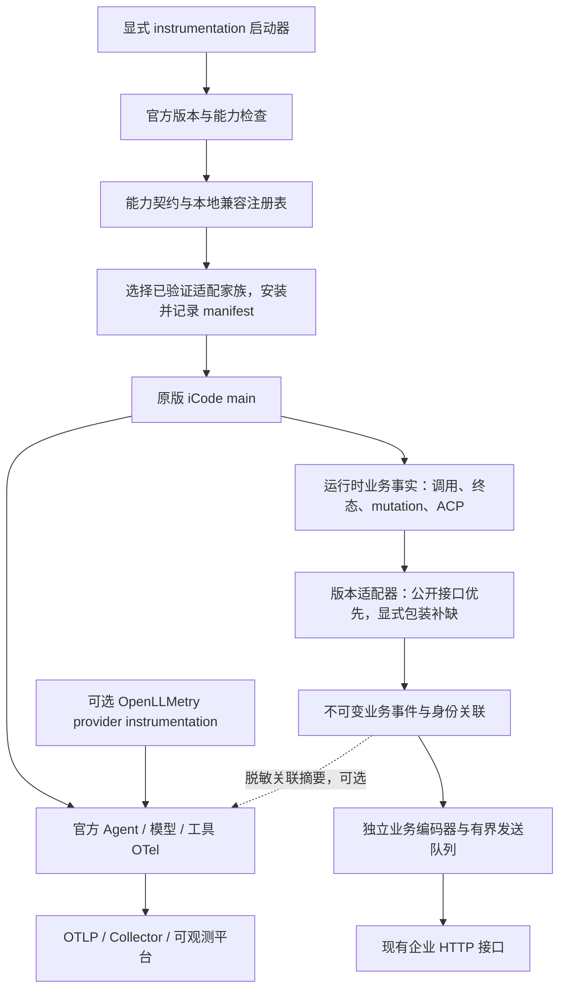

# 设计：基于官方 iCode 的外置 OTel 业务埋点改造

- 责任人：兰荣达
- 状态：已确认
- 确认日期： 2026-11-20
- 确认意见：已确认

> 2026-11-20 更新：按责任人新要求，以官方 0.36.0 为首轮运行时模拟目标，面向未来官方版本设计适配框架，不限制于 0.35.2。保留责任人本人填写的签认字段；本次正文更新不增加 R2 上游改动。ADR、依赖、独立仓库与运行时实验的前置条件仍按对应文档执行，不能仅凭设计文字声称实现通过。

## 1. 结论与边界

推荐独立 instrumentation 模块：官方 OTel 提供通用信号，显式启动器通过能力契约解析并加载适配器，在公开接口不足时运行时包装指定边界；企业业务规则、关联、编码与发送保持稳定且独立维护。OpenLLMetry 按缺口选用其 instrumentation，不 fork 其源码，不启动第二套全局 provider。0.36.0 是首轮模拟实例，0.35.2 是兼容回归实例，不将任何一个版本的路径固化进业务核心。

“零源码修改”指每个目标官方发行版的源码、依赖声明、入口文件的字节均不变；允许安装独立伴随包、改变启动命令和运行时包装。未来升级只能更新外置适配器、兼容配置与其测试，不能把修官方文件作为正常适配动作。它不是零运行时介入，也不是未来任意版本自动兼容：无法满足必需契约的新版本明确暂不支持，宿主照常运行，不通过猜测字段或改源码强行启用。

本批不修改 session 探索分支已有裁决，不代填“session 已废弃”。本设计建议不将 session 重建作为主数据源；正式路线切换由责任人签认本设计及 ADR 后生效。已交付版本继续生产运行，直到新路线完成对拍与替换验收。

## 2. 官方基线与业务基线

| 用途 | 唯一依据 | 限定 |
|---|---|---|
| 首轮模拟与适配验收目标 | 官方 openJiuwen-ai/iCode `v0.36.0`，提交 `78802f87d07f053fe560d680e4696c2bf322e2c2` | 官方 ls-remote 确认 tag，并以完整 SHA 读取源码；已完成静态对照，未运行模拟 |
| 兼容回归与能力演进对照 | 官方 `v0.35.2`，提交 `2fd777f626649d53d7ccd701e26a1a7ada569ce8` | 不用 fork 同名 tag；能否共用适配家族由契约与行为测试决定 |
| 业务字段、路径、状态、算法 | 已交付 fork `1709f237694b89f74deb4fb8fae47f216fe6c852` 的 telemetry-migration 文档、报文实现及脱敏 fixtures | 只提取业务需求，不把其新增字段、来源表或接线当作官方能力 |
| 历史研究 | telemetry-exploration 的风险与评审 | 只作风险输入，不默认继承其 ID、final-only 和删字段等全部裁决 |
| 演进探针 | 2026-11-20 查询官方 main 为 `90a3fb99c4d4ab476bdaf595bdace183e54dd7df` | main 与 release tag 分开，固定 SHA 作预警；不在生产自动跟随 main |
| 未来版本 | 新官方发行包/标签的独立内容摘要、Python/SDK/发行形态 | 新增验证记录与兼容配置，不改业务核心和官方源文件 |

官方源码永久链接使用各自完整SHA。两版11个共同Python文件静态对照为7同4变；11个候选接口签名相同，但tool_events结果hook、clients连接配置、engine与ACP实现有变化。静态相同不等于运行兼容；证据摘要见verification.md。官方源码副本、对比脚本及完整过程日志不纳入提交。

### 已核实能力及不足

下表描述已从两版官方源码核实的能力存在性，不表示运行时业务适配已经通过。工具结果 hooks 等语义有变化，必须按下文契约归一，不能只验签名。

| 官方文件/符号 | 已核实事实 | 不应推断出的结论 |
|---|---|---|
| kernel/instrumentation.py：ChatTelemetryLayer、AgentTelemetryLayer、get_function_span | 运行时模型/Agent/工具 spans 与 usage 指标已存在 | 不等于已有企业 requestId、审批或代码快照业务属性 |
| foundation/observability/setup.py：provider/exporter 安装 | 官方拥有 OTel 初始化与生命周期；provider 全局注册有约束 | 不能直接再 Traceloop.init 接管同一进程 |
| extensions.py：ToolCall、ToolResult | 工具参数、上下文、failed/rejected 等公开 | 没有完整文件快照、精确模型来源；provider-hosted 不经过此回调 |
| service/agent_middleware/events/extension_hooks.py | before 失败可拒绝工具，after 失败可替换结果 | 不能把业务网络发送放回调并假定永不影响主流程 |
| service/mutations/pipeline.py：finalize_mutation_tracking | 运行时生成逐次 mutation 结果及快照 | 不证明扩展 API 能直接取得它们 |
| service/agent_middleware/events/tool_events.py：process | 持有 FunctionInvocationContext；完成 mutation 后生成 metadata/file_snapshot | 仍须证明包装器在正确时点取得同次执行身份与快照 |
| service/llm/clients.py：_assemble_stack | 官方统一组栈为 ToolLoopLayer(ChatMiddlewareLayer(wire_client)) | 不存在 fork 新增的 telemetry_middleware 或来源字段 |
| orchestration/invoker/kernel.py：KernelConversation.run | 同进程有 RunRequest、origin 和明确调用范围 | 不能把 ambient ContextVar 跨后台任务当作永久身份 |
| app/acp/server.py：ChrysAcpServer.prompt | 可观测 ACP 输入、输出边界 | 额外企业 final-model-identity 仍需明确适配 |

## 3. 目标架构

业务记录是独立 instrumentation 包产生的一级事件，不能从采样后的 spans 反推。首版企业发送直接兼容现有 HTTP，避免把引入 Collector 或改造后台列为必需。OTLP 用于通用观测；后续可以增加企业事件 OTLP 接收适配，但需另审协议、采样和数据完整性，不能默认通用 Collector 会产生企业报文。

这仍属于 OTel/OpenLLMetry 风格 instrumentation：采集规则独立于宿主、显式装配、可卸载、可诊断。业务层不要求所有数据先经 OTel 才能上报，尤其不把代码正文塞入高基数 metrics。

### 3.1 跨版本分层与能力契约

稳定层为 facts schema、correlation、业务编码、过滤、发送和诊断，不导入宿主版本私有符号。宿主能力由下面的窄接口提供；一个适配家族可以服务多版，不为每个版本复制全部实现。

| 契约 | 稳定层需要的事实/动作 | 禁止的替代 |
|---|---|---|
| ModelCallSource | 调用开始、最终响应、流关闭/失败、业务调用与attempt关系 | 用最后请求或裸 span 父子关系猜模型来源 |
| InvocationScope | session、主/子/Workflow origin、logical/pass 范围 | 用 session-latest 或进程全局最近值 |
| ToolExecution | 真正执行 occurrence、参数时点、失败/拒绝/取消 | 按 provider ID 全局去重或按文本猜状态 |
| MutationSnapshot | 同次执行的官方快照、完整性及 operation关系 | 轮末读当前文件代替执行快照 |
| DesktopContext | ACP 输入、最终输出、安全合并官方 meta | 依赖固定源码行号或覆盖整个 meta |
| HostLifecycle | 调用前安装、真实 loop 内资源、有界关闭 | 多建 provider/事件循环或后台任务脱离 owner |

版本适配器负责把官方形态转为这些契约。版本号只决定候选，不证明兼容；参数名、签名、返回协议、from-import 绑定、事件形状和结果处理阶段全部属于能力探针。探针只做受控检查，不在用户会话执行工具副作用，不扫描栈帧或猜未知成员。

### 3.2 兼容注册表、选择与升级策略

伴随包携带本地、版本控制的适配家族与兼容注册表。每条记录包含：官方发行版/版本/内容摘要、Python与OpenAI/Anthropic/OTel依赖组合、安装形态、能力契约版本、每个定义/调用绑定与签名/协议约束、行为门禁证据、必需/可选能力、状态、采集规则版本。官方 SHA 用于源码证据，wheel 内容摘要用于实际安装物识别，不能假设 wheel 自带 Git SHA。

注册表状态分 `source-reviewed`（源码核实）、`runtime-verified`（模拟通过）、`qualified`（目标环境/业务验收通过）与 `unsupported`。当前两版最多为 source-reviewed。生产只启用 qualified 记录；模拟环境可显式加载被测记录，输出不进入生产。匹配到同名版本但内容摘要不同、只通过签名或是未知依赖组合时都不能自动提升状态。

选择流程：发行物识别→能力预检→选择唯一已验证的适配家族→检查必需能力与业务上下文→安装事务→记录实际激活状态。无唯一匹配或关键能力缺失时不安装该业务组，宿主正常继续；可选业务必须预先批准降级且诊断逐项呈现，不能声称全量采集。禁止联网下载并执行未审查适配器。

未来版本若能力契约与语义未变，可复用同一适配家族，只新增验证证据和注册表映射；若宿主边界变化，只改对应 adapter/binding profile；若共同事实不足，标 unsupported 并等待外置新适配器或上游正式能力，不修改官方源码。语义版本范围只能描述已验证范围，不能写“>=0.36 永久兼容”或通配所有未来版本。

## 4. 备选方案对比与 R1/R12

| 路线 | 优点 | 代价/升级耦合 | 建议 |
|---|---|---|---|
| 维持已交付源码接线 | 业务已有验证 | 上游文本与语义接触面继续存在 | 生产回退基线 |
| session 事后重建 | 利用现有保存数据 | 压缩/回滚/保存与跨文件一致性、扫描及 reader 版本耦合 | 不推荐主采集，保留诊断用途 |
| 仅官方 OTel/公开 extension | 源文件零改动，公开面维护低 | 不足以证明代码快照、完整关联、ACP 全部业务 | 优先复用，不能单独承诺全覆盖 |
| 全量 Traceloop SDK 自动接入 | 模型生态接入方便 | 重复 spans、provider 初始化、传递依赖和内容采集风险 | 不作为默认装配 |
| 官方 OTel＋独立版本适配器＋可选 OpenLLMetry | 所有业务外置，官方文件不变、运行时取得事实 | 私有宿主方法签名与时序仍耦合；需显式 manifest 与版本门禁 | 推荐验证路线 |

R1 结论：可尝试通过独立启动与显式包装实现官方源文件零变更；但不能用零 diff 掩盖私有接口耦合。包装不优先于足够的公开 API；不成立时停止并重评，不暗加源码补丁。官方接线是否优于旧实现，按真实事实覆盖和已验证的适配边界评估，不按文件数单独裁决。

## 5. 部署、装配及分发

### 5.1 独立发行包是目标

产品形态为伴随发行包 `aixcoding-icode-instrumentation`（提议名称），自身顶级 Python 包独立于 `chrys`。原版 `iCode-TUI` 每个受支持发行物均保持原样；首轮模拟固定 `0.36.0`，同时把 `0.35.2` 列入回归目标，伴随包不永久绑定一个 iCode 精确版本。测试环境各自锁定被测版本与依赖，生产按注册表声明支持组合，不通过无上界依赖范围代表兼容承诺。新启动器先装 instrumentor，再延迟调用所选官方入口；入口位置变化由 adapter 提供，不复制 CLI 解析、bootstrap 或事件循环。

启动示意：`<独立启动器> run ...`、`<独立启动器> acp`；这是拟议命令，不是已可执行功能。原 `icode` 保持原行为；生产入口通过安装/桌面配置显式指向启动器。`sys.argv`、退出码、信号、stdio 和 cwd 等价性必须测试；ACP stdout 仍为 JSON-RPC，诊断仅 stderr/日志。

不能从外部 Python 进程包装一个已运行或独立封装的 iCode 二进制的内部函数。首版支持同 Python 环境 wheel/source 部署；PyApp/冻结二进制必须单列验证其伴随包加载和真正应用入口。无法同进程装配则标不支持，不声称跨进程自动生效。serve 重启/子进程、Workflow 3.9 worker 及 ACP 外部 Agent 也不自动继承；只能按明确入口和版本策略处理。

### 5.2 本仓目录规范与独立包边界

本轮只新增本批六件文档和全局 ADR 草案，零产品代码。本仓现有 DIRECTORY 规定产品代码落 `src/chrys/{tier}/aixcoding/`，不允许擅自在根 aixcoding 放一个运行时 Python 项目。因此独立伴随包实施优先放**另一个专用仓库**，本仓仅保留业务契约、联调测试与设计；仓库地址/制品名称由责任人指定，未指定前不创建外部项目、不发布。

若决定在当前 fork wheel 内实现，必须改为分 tier 的定制模块，此时仍可做到不改上游文件，但不再声称“独立 wheel＋官方 wheel 原样安装”。不得以本设计默许新命名空间落点或构建规则豁免。独立包仓库未落定不影响本设计评审，但阻塞正式编码与发布配置。

### 5.3 生命周期

安装顺序：配置冻结前读取外置配置→核验官方发行版/版本/能力→装配全部候选 wrapper→调用官方 main。未知版本、签名不符或其他 instrumentor 已占用时，拒绝启用该业务适配组，输出诊断；默认宿主继续运行，业务采集状态标 unavailable，不能默默报部分成功。

install/uninstall 幂等；每个包装保存原对象与所有权标记，仅在当前对象仍是本包装时恢复，不覆盖其他插件的新包装。并发任务在原调用开始时取得不可变 scope；不得在调用中途卸载。恢复原对象后关闭自有资源，不关闭官方 provider。动态反复开关不作为首版能力，使用重启边界。

## 6. 运行时适配点与禁止依赖

以下是从官方 0.35.2/0.36.0 核实的**首个适配家族候选边界**，不是通用于所有未来版本的硬编码接口，也不是已证明全部可包装或隐藏接线批准清单。具体绑定留在注册表/adapter，业务核心只使用 §3.1 契约。每组须有对应 official-SHA 行为测试和装配诊断。

| 组 | 官方边界 | 包装目的 | 风险/首轮判别 |
|---|---|---|---|
| A1 | service/llm/clients.py：_assemble_stack 或公开 ChatMiddlewareLayer 装配点 | 单次调用加定制 middleware，捕获请求前业务身份和最终响应来源 | 返回类型、同步/异步/流形态不变；不同时启用两组模型捕获 |
| A2 | orchestration/invoker/kernel.py：KernelConversation.run | 将 session/invocation scope 绑定到调用，finally 清理 | 主/子/Workflow 分开，不能从 latest 推导 |
| A3 | 公开 FunctionMiddlewarePipeline.execute，必要时 service ToolEventMiddleware.process | 对实际工具执行绑定 occurrence、参数和 metadata 生命周期 | 快照是否在返回前可取得，审批重绑后参数时点，同 provider ID 多次执行 |
| A4 | service/mutations/pipeline.py：finalize_mutation_tracking | 在官方持有锁内快照的结果处复制事实，禁止自行读工作区冒充 | 需要与 A3 execution scope 精确合并；没有 scope 则不猜归属 |
| A5 | orchestration/engine/engine.py：prepare/start/shutdown 或集中释放路径 | 在真实 loop 内 attach/close 队列，事件只作语义补充 | 所有正常出口、异常、取消与跨 session，不依赖外部 hook 开关 |
| A6 | app/acp/server.py：ChrysAcpServer.prompt（retry 按该版官方调用链判别） | 捕获输入及响应合并，不覆盖官方 meta | prompt 锁、双会话、取消、最终 A1/A2、真正 retry 响应边界 |

不得导入 kernel 私有 `_*.py`、复制其函数体或修改类定义来补字段；kernel 通过公开导出访问。service/app 私有方法若确须包装，集中版本适配且纳入 ADR。禁止裸按 provider call_id 全局关联、按列表位置配对、跨 await 持有失效 loaded、修改原消息 metadata 来假造官方字段。不得依赖 fork 的 model_source_id/tool_operation_id/workspace 等新增事件字段。不能通过构造伪原版基线或关闭架构检查来通过实验。

### 实际调用绑定与安装事务

官方 tool_events.py 用模块级 `from ...pipeline import finalize_mutation_tracking` 绑定函数；仅替换定义模块属性不保证命中已加载调用方。版本 manifest 必须列**定义点与实际调用方绑定点**，按白名单导入顺序一次装配并验证对象关系；已加载的已知别名若需替换，逐个登记原对象及恢复所有权。不得全局扫描 sys.modules 猜测补丁，也不得依赖未保证的“启动够早”掩盖别名风险。

安装事务先对全组定义/调用绑定做预检，再统一替换；任何一步失败只撤销本组已安装且仍归自己所有的绑定。G2 必须通过真实工具调用证明 finalize 入口实际经过 instrumentor，并验证禁用/卸载后恢复原调用路径，不能只断言模块属性已变化。子工具若有独立调用模块，必须查官方真实绑定后单列，不默认主工具的绑定覆盖它。

wrapper 只调用原函数一次；捕获逻辑异常隔离，但原函数异常及 CancelledError 原样传播。流式返回值不得提前消费、合并或改变其异步协议；若缺少稳定公开结果观察点，先把该协议标未支持，不构造近似流包装交付。

0.36.0 的工具结果 hook 已支持不同于 0.35.2 的 result override/extra context 处理。适配事件须区分工具真实执行结果、hook 后模型可见结果与业务编码采用的阶段，不能让 hook 修改文字把失败变成业务成功，也不能默认所有版本的 process 返回时内容相同。模型连接的 discovery 可关闭请求 hooks，探测流量不冒充 agent 业务调用。上述变化虽未改变部分候选签名，仍需独立语义测试。

## 7. 业务事实、关联和幂等

### 7.1 独立不可变事实

内部事件至少含 schema_version、event_id、event_type、session_id、invocation 身份、logical_turn_id/pass_id（可证时）、model_call_id、tool_occurrence_id（工具类）、业务状态、来源类别、时间点语义与数据完整性原因。参数/快照在真实边界复制，不能在后台任务读可变 context 或当前文件。大代码块用受控的有界 payload，不进入 resource attributes/baggage/metrics。

缺身份不得借上一轮或最近模型；同一 provider call_id 的重复发生使用实际执行身份区分。身份来源未在官方 baseline 验证前不得标完整支持。

### 7.2 业务 ID 与观测 ID 分开

保留企业业务 requestId/funcId/reportId 等语义，OTel trace_id/span_id 仅用于关联属性，不能直接替换。trace_id、span_id 的长度和范围并不相同，也不等于 iCode attempt 或 logical turn。首版兼容已交付模型 middleware 的企业 requestId 粒度：SDK 内重试不必新生成企业 ID；wire retry/新 middleware 调用按对拍规则处理。新 raw-attempt/final-only 方案属于另一个业务协议决定，不默认沿用 session 草案。

模型 A1 产生工具，A2 给最终回答：工具和代码挂 A1，ACP 最终身份通常取 A2。保留模型来源与工具 occurrence 的 out-of-band 有界关联表，按 session/invocation/pass 隔离，容量与释放有明确定义。不能仅依赖模型 span 当前是工具 span 的父级来推断“哪个响应产生工具”。

### 7.3 能力矩阵

| 业务 | 外置采集 | 首版兼容目标 | 必须验证/不可静默降级 |
|---|---|---|---|
| LLM 业务记录 | A1 请求前 middleware＋响应来源 | body.telemetry 现有字段和业务 ID 粒度；辅助调用单独归类 | 模型请求复制 options 后合并，不修改共享配置；三协议和全部重试层 |
| 工具明细 | A3＋官方终态 metadata | save/PENDING/terminal 与失败/拒绝口径 | 非异常 tool_error 不能当成功；取消单列；同 ID 多执行 |
| write/edit ai-code | A3/A4 同次官方前后快照 | 原支持工具、片段算法、逐次行数、审批语义 | 不用前后自行读盘替代锁内快照；同文件并发/连续编辑 |
| load_skill | 实际工具执行 occurrence | 按已交付实际加载口径计数，引用提醒不计加载 | 重复实际加载分别计；不按技能名全局去重 |
| selected Agent 1001 | A6 输入＋模型调用事实 | 保留既有业务触发；不因 retry 重复计一轮选择 | 当前 logical turn 关联规则与失败场景由业务矩阵固定 |
| ACP 最终身份 | A6＋当前 invocation 关联表 | 保留企业 envelope 并合并官方 meta | 不从 session 文件重建，不用 session-latest |
| 公共字段 | 调用时 config/workspace/ACP 快照 | 无 workspace 不回退安装目录；Git 明确时点 | 用户/凭据/模型切换不能串 session |
| 本地子 Agent/Workflow | 同一运行时链路，显式 origin | 以已交付覆盖为需求，不继承 session 的默认退出 | 外部 ACP 内部模型/工具仍不可观测，不伪造 |
| hosted 工具 | 官方模型响应/hosted 事件 adapter | 列为独立验收组 | 只见模型声明不等于本地真正执行；源缺失策略需裁决 |

以上是需求目标，不是已支持清单。每个事件出站前统一 catalog 模型归属过滤；tool/code 按来源 A1，ACP 按最终调用；自定义/不可判定按已确认业务政策跳过并计数。call-time 还是分析时模型归属必须在 requirements 中明确，不因采用新技术偷偷换语义。

### 7.3.1 官方原版之外的企业上下文输入

官方原版不负责企业登录、catalog 同步或生成 fork 的 `synced_from_server` 标记。独立包不能导入已交付 fork 的 auth/catalog 产品模块；部署必须显式提供下列输入 provider。它们是伴随包的部署依赖，不是要求修改官方源码。

| 输入 | 提议来源与契约 | 缺失处理 |
|---|---|---|
| 后台地址、环境、产品版本、策略 | 独立部署配置，安装器/用户显式指定的文件或环境；schemaVersion 与内容哈希可诊断 | 业务组不启用并标 unavailable，不偷偷使用云端默认 endpoint |
| 企业主体与发送凭据 | 独立 CredentialProvider，提供 principal_id、token、过期/刷新状态；可接部署方凭据服务，现有登录兼容需另核对其存储契约 | 凭据缺失不发送、不提示宿主 ask_user；后台刷新不阻塞工具 |
| 模型 catalog 归属 | 独立 ModelOriginProvider：官方 profile 稳定身份到 server/custom/unknown 的版本化映射，由部署方 catalog 服务或受控配置提供 | 未配置 provider 则整个过滤业务组 unavailable；不能把全部模型被跳过当成采集健康 |
| 工作区、实际模型和 Agent | A1/A2/A3 从官方调用对象获取实际值，映射不能依赖显示名或 provider 模型名全局唯一 | 不可证则对应记录 unsupported，禁止安装路径/cwd 猜测 |
| desktop、selected Agent、attribution | A6 捕获当前 ACP 输入并冻结到该 invocation | 缺输入按明确规则省略/跳过，不借进程最近值 |

模型归属采用**调用时 provider 的不可变版本快照**，tool/code 沿用 A1 快照，最终 ACP 沿用其实际模型快照。映射变更只影响后续调用；没有显式快照时不在发送时重新分类。纯官方自建 profile 可通过部署映射显式标为允许上报的 server-owned，不能假设安装原版会自行同步企业 catalog。

每个业务事件记录捕获时 principal_id；发送时凭据刷新仍须属于同一主体/受众。若账户切换，新 token 不得发送旧主体队列，按策略隔离或丢弃并计数。provider 只暴露最小值，不把 api_key 或 token 写入 OTel。对 provider 的现网对接属于实施工作，本设计不虚构已有服务 API。

部署预检要区分配置缺失、映射 unknown、合法 custom 过滤及真实零调用，诊断包含计数和原因而非敏感值。验收至少包括官方原版配置一条 server-owned 映射后确有业务报文、自定义映射确实过滤，防止零报文假通过。

### 7.4 网络与重放

企业 worker 使用不可变 DTO，有界队列、按 session 有序、跨 session 有并发上限；网络不在 EventBus inline、公开 extension 或 span processor 回调内等待。复用已交付协议的状态顺序与错误映射；后台未证原子幂等前，不能任意重试非幂等 save，不能承诺 exactly-once。只读诊断输出 sent/failed/dropped/conflict/unsupported，不输出 token 或完整 prompt。

首版 best-effort，正常退出有界 drain，强杀不保证。容量、超时、flush 与最大 payload 是可配置的明确预算，首轮试验根据受控负载定值后写入正式设计，不填未经测试的性能承诺。内存只保留有界关联，结束、失败、取消和超时均清理；HTTP client 在所属事件循环内关闭。

## 8. OTel 与 OpenLLMetry 的装配原则

官方负责一次 provider 初始化，伴随包不主动设置第二个全局 provider、不偷偷更改 CHRYS_OTEL 开关或敏感开关。官方 OTel 关闭时，通用观测保持关闭；企业业务发送是独立、明确的部署配置，不能用它绕过用户对内容外发的授权。

OpenLLMetry 优先只启用已证有增量价值的 provider instrumentor。官方已完整采集的层不重复计数。`Traceloop.init()` 整套初始化默认不采用；若没有增量价值，可交付 OTel 兼容自有 instrumentor 而不新增 OpenLLMetry 依赖。技术方案采用其生态方式，不以包名作为验收条件。

可观测 trace 可以采样，业务事实流不能依赖被采样 span 的 on_end，也不能让 BatchSpanProcessor 丢弃决定业务记录完整性。未来若业务也走 OTLP，必须独立无采样事件通道并验证内容限制、排队与接收幂等；不要把每条业务记录伪装一个大 span。

## 9. 安全、性能与可维护性

内容字段按企业既有授权白名单发送；默认不额外采 prompt/完整工具输出，不将 token 放 attribute；代码片段、路径和 Git 用户信息按已确认业务范围最小化。远端 endpoint 与认证显式配置，凭据发送时读取，日志不回显。ACP stdout 不得打印装配状态。

性能重点测工具主路径复制快照、流式 pull/close、队列背压和 Git 采集。不得为埋点重复扫描 Git/目录或读取全 session；不得在 SDK span 回调跨 loop 使用 async client。业务采集失败不改变模型可见工具结果、批准决定、原始异常、重试次数或流式时序。

版本 manifest 采用 §3.2 注册表契约；验签名不等于验证语义。每次官方发布在隔离 CI 固定制品及依赖，跑能力探针、G1–G4和回归矩阵；同一业务语义 fixture 跨版本对照，main 仅做预警，不自动作为可发布版本。当前仅设计该 CI，不修改工作流、不新增自动化调度。install 事务先预检全组，失败撤回本次 wrapper；卸载遵守所有权，不踩其他插件。禁止全局 sitecustomize/PYTHONPATH 注入无关 Python 进程，禁止隐式命令劫持。

## 10. 零源码修改、包装登记与 R2

当前设计阶段上游修改：**0 文件、0 行**，无依赖安装，无原命令或构建配置更改。实施验收对官方清单逐文件 hash，运行前后均一致；伴随包有独立目录/制品，不能将打过旧埋点的 fork 当官方原版通过。

运行时接触面并非零：第6节 A1–A6 全部纳入适配 manifest 和真实调用回归，不冒充无需登记。现有 gen_customizations 只认源码 marker，本批不伪造源 marker 或把运行时 wrapper 填作已存在 marker。正式实施前在 ADR 中明确 runtime 接触登记机制及规范落点；若需要改变治理工具/标准或当前仓构建，另列真实 R2 后审批，不借本设计默许。

删除已交付上游旧埋点属于另一个 R2 变更，不在零修改试验中进行。验证使用官方原版独立环境；生产迁移时保留单一发送权，不在已带旧代码的进程上默认叠加新 instrumentor。

## 11. 第三方依赖与 R11

本轮新增依赖：无。实施优先复用官方 OTel API/SDK 与标准库。官方自身 lock 中的 instrumentation/wrapt 只证明存在，不代表伴随包可以不声明直接依赖，也不代表本仓已批准直接使用。

| 候选 | 处理 | 引入前必须完成 |
|---|---|---|
| 官方已含 opentelemetry-api/sdk | 先复用同一环境并核对官方 lock | 避免 provider 与版本冲突 |
| opentelemetry-instrumentation / wrapt | 仅若手工包装无法可靠保持 descriptor/async 语义再申请 | 直接依赖声明、精确版本与 hash、许可证、传递树、Python3.14/离线轮子验证 |
| OpenLLMetry 单项 instrumentor | 依据三协议实测缺口选择，默认不安装全量 SDK | 精确版本、Apache/MIT 等实际许可证核实、SDK支持矩阵、内容控制、依赖树与锁冲突 |
| traceloop-sdk 全包 | 暂不引入 | 若后续改变需重新比选与 R11 申请 |

不预填未经查证的版本。正式实施选中的依赖前，须单列五项完整申请（标准库/已有依赖为何不足；许可证；维护与传递树；不可变版本；lock/离线打包影响），在伴随包lock锁定，审批人/日期由人填写；未选定版本的OpenLLMetry路径仍为条件分支，不能仅凭design确认状态安装。

## 12. 实施顺序与停止条件

1. 固定官方 0.36.0 首轮模拟制品与 0.35.2 回归制品；完成业务矩阵、能力契约和注册表设计；独立包仓库/入口及 ADR/依赖前置条件确定。
2. 先在官方 0.36.0 隔离环境模拟 G1–G4：装配/卸载、A1→write/edit→A2 的快照来源、并发/retry/stream-close、ACP 输入与最终响应；宿主文件前后 hash 一致。模拟范围不是生产上线授权。
3. 用同一业务核心与 fixtures 对照官方 0.35.2；证明共同能力可复用、差异被局限在 adapter，不复制整套业务实现。两版分别记录结果，不能相互代替通过。
4. 决定性门禁通过后完善业务 facts/编码/队列和 T1–T16、主/子/hosted/Workflow、性能、OS及发行包验收，OpenLLMetry 按证实缺口纳入。
5. 新版本通过隔离发布门禁再纳入注册表；真实后台/桌面和单写切换/回退通过后替换生产，不提前删除已交付链路。

停止条件：关键事实无法在函数可见边界取得；必须靠不受控栈帧/局部变量窥探；流式包装改变消费/关闭语义；必须改官方核心文件才补齐必需字段；安装形态不能同进程加载；包装成本超过可接受维护面。命中即停并记录，不回退 session 或源码修改，除非责任人重新选择方案。

## 13. 风险与回滚

主要风险为版本耦合、重复采集、来源错配、对流/取消的扰动和原生发行不可加载。公开扩展只能辅助，不因其异常可能替换工具结果而进入关键网络路径。先检查原版运行与新启动器运行的行为等价，不能只检查报文存在。

试验回滚：改用官方原 `icode` 启动，不加载伴随包。生产回滚：停止新实例、排空或记录丢弃，再启动已交付旧版本；同一实例永远一个企业发送 owner。不同 ID/协议的双写不能靠后台自然去重，历史数据不默认迁移。卸载包不修改官方文件，未结束调用不热卸载。回滚保留诊断而非私人原始 payload。

## 14. 文件与交付清单

本次仅提交requirements/design/test-plan/plan/verification/self-review六件文档及 `standards/adr/telemetry-otel-instrumentation--external-runtime-adapter.md` 草案。源码对照摘要合入本文与verification，不另存research副本。实际产品代码、依赖、mock及安装器不在范围。

拟议独立包模块：launcher、instrumentor、contracts、compatibility/registry、adapters/families、adapters/bindings、facts、correlation、business_encoder、delivery、diagnostics。适配家族可复用，共同业务不按版本复制；禁止核心模块出现宿主版本私有路径分支。模块在独立仓按其规范落位。当前 fork 仅新增联调测试时落 `aixcoding/tests/telemetry_otel/`，mock 若需扩展按既有 mock 规则，勿新建产品代码于根 aixcoding。

定制点登记预告：当前仅文档，无 active 源码 marker。第6节为 runtime 接触面预告，实施前完成注册规范决定；不要为未写的代码制造孤儿登记。

## 15. ADR 判定与待裁决事项

ADR 四问：①认真比较并排除 session 主链/全量 SDK；②对外身份和部署耦合撤销有成本；③长期版本适配模式；④依赖宿主非公开方法。全部命中，已起草本批 ADR，保持草案，不能以现有 R1 对运行时包装的提及当作本具体方案已批准。

责任人已明确：不局限 0.35.2，以官方 0.36.0 作为新模拟目标，未来版本通过外置兼容层适配，官方源码始终不改。本次不修改本人已填写的签认字段，R2 仍为零。待明确：独立仓库/分发入口、Python wheel 支持边界、业务必保留与降级、runtime 登记机制、选中依赖后 R11；ADR 仍草案，不能据 design 的确认状态声称其他前置条件已满足。

## 16. 官方参考

- [官方 0.36.0 模拟基线](https://github.com/openJiuwen-ai/iCode/tree/78802f87d07f053fe560d680e4696c2bf322e2c2)
- [官方 0.35.2 回归基线](https://github.com/openJiuwen-ai/iCode/tree/2fd777f626649d53d7ccd701e26a1a7ada569ce8)
- [0.36.0 官方 OTel 层](https://github.com/openJiuwen-ai/iCode/blob/78802f87d07f053fe560d680e4696c2bf322e2c2/src/chrys/kernel/instrumentation.py)
- [0.36.0 官方工具事实与快照](https://github.com/openJiuwen-ai/iCode/blob/78802f87d07f053fe560d680e4696c2bf322e2c2/src/chrys/service/agent_middleware/events/tool_events.py)
- [0.36.0 官方扩展 API](https://github.com/openJiuwen-ai/iCode/blob/78802f87d07f053fe560d680e4696c2bf322e2c2/src/chrys/extensions.py)
- [OTel Python 自动 instrumentation 机制](https://opentelemetry.io/docs/zero-code/python/)
- [OpenLLMetry 无全量 SDK 接入](https://www.traceloop.com/docs/openllmetry/tracing/without-sdk)
- [OpenLLMetry 初始化与内容采集配置](https://www.traceloop.com/docs/openllmetry/configuration)

源码能力来自官方固定提交；OpenLLMetry 的官方说明仅证明机制，不证明其与本版本 iCode 的业务兼容性。
